<div align="center" dir="rtl">


# Cmail

[](https://github.com/Erfan-8910/Cmail/releases)
[](https://workers.cloudflare.com)
[](#کل-سیستم-در-یک-نگاه)
[](LICENSE)
[](https://deploy.workers.cloudflare.com/?url=https://github.com/Erfan-8910/Cmail)

**یک اکوسیستم کامل ایمیل که تماماً داخل حساب Cloudflare خودت زندگی می‌کند — یک فایل ورکر، یک دیتابیس، صفر سرور، صفر قبض ماهانه.**

[راهنمای نصب](docs/DEPLOY.fa.md) · [راهنمای استفاده](docs/USAGE.fa.md) · [نسخه‌ها](https://github.com/Erfan-8910/Cmail/releases) · English — [README](README.md)

</div>

---

## Cmail چیست؟

Cmail پاسخ یک سؤال ساده است: **چرا برای یک صندوق ایمیل اجاره بدهیم؟**

تمام این اکوسیستم داخل همان حساب Cloudflareای اجرا می‌شود که از قبل داری. ایمیل‌های ورودی از مسیر **Email Routing** می‌رسند، همه‌چیز در **D1** (همان SQLite لبهٔ شبکه) ذخیره می‌شود و کل رابط کاربری — صفحه‌ها، استایل‌ها، اسکریپت‌ها، فونت‌ها و آیکون‌ها — توسط **یک فایل Worker** سرو می‌شود. نه سروری هست که نگه‌داری، نه دیتابیسی که تنظیم بخواهد، نه پنل اشتراکی، و هیچ‌چیزِ قابل‌گرفتن از دستت.

به‌جایش یک فضای ایمیل شخصی می‌گیری که واقعاً مال خودت است: دامنه، داده، کلید. آدرس‌های یک‌بارمصرف برای ثبت‌نام‌ها، صندوق‌های دائمی برای کارهای جدی، یادداشت رنگی زیر هر نامه، گاوصندوق 2FA داخلی، ارسال ایمیل از دامنهٔ خودت — همه در یک پنل شیشه‌ای که فارسی و انگلیسی حرف می‌زند.

## دیوار امکانات

| | |
|---|---|
| ⭕ **دایرهٔ حساب‌ها — تنها محل تعویض حساب** | هر صندوق، یک حساب مستقل است و دایرهٔ بالای صفحه تنها جایی است که حساب‌ها عوض می‌شوند — هر حساب جزئیات ریز خودش را قبل از ورود نشان می‌دهد: چند نامه گرفته، چند کد 2FA نگه می‌دارد، چند نخوانده دارد. از همان پنل **حساب جدید** هم اضافه می‌شود. هیچ‌جای صندوق — نه نوار کناری، نه پوشه‌ها، نه سرستون — به‌خودی‌خود حساب را عوض نمی‌کند. |
| 📂 **بیضی هویت و یک کارتِ بزرگ** | صندوق مثل سرویس‌های بزرگ‌سال خوانده می‌شود: **بیضی هویتِ** حساب — چهره، اسم و آدرس کامل با دکمهٔ کپی — بالای یک کارتِ زنده که کل صندوق را در خود دارد. نوارابزار با انتخاب‌همه، رفرش و نقطهٔ نفس‌کشِ به‌روزرسانی خودکار؛ ردیف‌های تک‌خطی (چهره · فرستنده · موضوع — پیش‌نمایش · ستاره · زمان)؛ و ریل پوشه‌ها کنارش با **همه · نخوانده · ستاره‌دار · یادداشت‌دار** و شمارندهٔ زنده — به‌علاوهٔ **پوشه‌های خودت برای هر حساب**، هر کدام با نقطهٔ رنگی، شمارنده و قانون فرستندهٔ اختیاری که نامه‌های تازه را خودش بایگانی می‌کند. |
| 📄 **هر ایمیل، صفحهٔ خودش** | بازکردن نامه دیگر پاپ‌آپ روی فهرست نیست — به یک صفحهٔ واقعی با آدرس خودش می‌روی: دکمهٔ بازگشت، فلش‌های قدیمی‌تر/جدیدتر، نوار کامل اقدامات. ایمیل HTML سندباکس‌شده و ضدِدستکاری رندر می‌شود؛ متن ساده هم کلید نمایش خودش را دارد. |
| ⏱️ **صندوق خودش نفس می‌کشد** | هر ۱۰ ثانیه یک بار بی‌صدا نامه‌های تازه را چک می‌کند، نامهٔ تازه را هایلایت می‌کند و نشان‌های خوانده‌نشده را همگام نگه می‌دارد — دیگر لازم نیست محکم‌کاری دکمهٔ به‌روزرسانی را بزنی. و هیچ بارگذاری‌ای بی‌صدا نیست: نوار پیشرفتِ باریکِ زنده بالای صفحه و نوار وضعیتِ صندوق، همیشه می‌گویند چه خبر است. |
| 🩺 **سلامت سامانه، روی صحنه** | گزارش کامل سلامت در تنظیمات: اتصال D1 با تأخیر لحظه‌ای، تک‌تک جدول‌ها با تعداد ردیف و وضعیت ستون‌ها، ضربان کرون، و جریان ایمیل — هرکدام با دکمهٔ ترمیم خودش. |
| 🚨 **مشکل‌ها خودشان را اعلام می‌کنند** | وقتی چیز جدی‌ای می‌شکند — D1 قطع، جدول ناقص، ساختار قدیمی، توقف جریان ایمیل — بنری بالای برنامه ظاهر می‌شود که علت و راه‌حل یک‌کلیکی را کنار هم می‌گوید. خبر را اول از برنامهٔ خودت می‌شنوی، نه از صندوقی که کار نمی‌کند. |
| 🌐 **ویزارد وصل‌کردن دامنه** | دامنه را که اضافه کردی دستت را می‌گیرد: اول راهنمای تمیز اتصال در Cloudflare، بعد یک کد صحت‌سنجی که خودت به دامنه‌ات می‌فرستی. صفحه هر چند ثانیه خودش را دوباره چک می‌کند تا حلقه ثابت شود — و بعد صندوق‌ها باز می‌شوند. وسط کار رفتی؟ پیش‌نویس با نشان وضعیت و دکمهٔ **ادامهٔ اتصال** هم در صفحهٔ راه‌اندازی می‌ماند هم در صفحهٔ دامنه‌ها — هیچ‌وقت لازم نیست دامنه را دوباره بنویسی. |
| 🎨 **اتاقی که با رنگ تو هم‌رنگ می‌شود** | کل محیط با پالتی که انتخاب می‌کنی یک‌جا رنگ عوض می‌کند: **سبز · آبی · بنفش · کهربایی** — هر پالت با نام خودِ رنگ، نه تشبیه و نه اسم چیز دیگر — هرکدام درخشش پس‌زمینه، شیشه، اکسنت‌ها و هایلایت‌ها را در یک نفس هم‌رنگ خودشان می‌کنند. سه حالت حضور — **متحرک**، **ساکن**، **ساده** — انتخاب می‌کنند پس‌زمینه چقدر جان داشته باشد. |
| 🔎 **بازرس D1** | صفحهٔ راه‌اندازی هر جدول مورد انتظار را با تعداد ردیفش نشان می‌دهد؛ ناقص‌ها را با یک دکمه بساز، جدول‌های بیگانه را پاک کن، دیتابیس‌ات منظم بماند. همین بازرس برای همیشه در تب سلامت هم هست. |
| 🗒️ **یادداشت روی ایمیل‌ها** | یک یادداشت شخصیِ رنگی زیر هر نامه — شماره سفارش، لینک رهگیری، هرچه. جست‌وجو فوری پیدایش می‌کند. |
| 👤 **هر صندوق یک حساب است** | هر میل‌باکس مثل یک حساب مستقل رفتار می‌کند: نامه‌هایش، یادداشت‌هایش و کدهای 2FA خودش، همه داخل همان فضا می‌مانند. |
| 🔐 **گاوصندوق 2FA — حساب‌به‌حساب** | یک احرازکنندهٔ داخلی: کدهای ۶ رقمی زنده با حلقهٔ شمارش، رمزنگاری‌شده با AES-256-GCM، ۷۷ نشان آماده. گاوصندوق همیشه روی حسابی که داخلش هستی باز می‌شود — و **پوشه‌ها مالِ یک حساب‌اند**؛ پوشه‌بندیِ حسابِ دیگر هرگز کدهای این حساب را قاطی نمی‌کند. |
| ❄️ **یخ‌زده تا وقتی خودت تصمیم بگیری** | دکمهٔ ارسال ایمیل و گاوصندوق آدرس‌های موقت تا وقتی مجوزشان تنظیم نشده، کنار لوگوی خودشان نشانِ یخ‌زدهٔ برف‌وِقفل دارند — لوگو سر جایش می‌ماند، نشان حقیقت را می‌گوید. مجوز را یک بار بدهی، نشان به شعلهٔ باز تبدیل می‌شود و پنجرهٔ مسئولیت دیگر تکرار نمی‌شود. |
| 🤝 **یک صندوق را به اشتراک بگذار — یا پنج‌تا** | به هر کسی یک دسترسی مهمان بده برای **هر تعداد صندوقی که انتخاب می‌کنی**: نام کاربری/گذرواژهٔ خودش (همیشه دوباره پیدا می‌شود، **Regenerate** جفتِ تازه می‌ریزد)، فهرست اجازه‌ها (خواندن · ستاره · آرشیو · حذف · ارسال · یادداشت)، انقضا با پیش‌فرض‌ها، سقف دستگاه، حتی یک پیام خوش‌آمد که مهمان هنگام ورود می‌خواند. هر دسترسی **فهرست دستگاه‌ها** و **فهرست نشست‌ها**ی خودش را دارد — تک‌تک را همان لحظه غیرفعال کن — به‌علاوهٔ حسابرسی زنده، بیرون‌انداختن با یک فشار، ابطال آنی و کلید تعلیق دستی با انتخابِ **ثابت ماندن زمان / کم شدن از تایم**. مهمان‌ها از درِ **ورود اشتراکی** روی کارت ورود وارد می‌شوند، زیر یک **داینامیک آیلند** جمع‌وجور زندگی می‌کنند و چیزی جز همان که داده‌ای نمی‌بینند — کنترل‌های بی‌مجوز اصلاً رندر نمی‌شوند. |
| 🛡️ **2FA حساب** | خودِ ورود هم می‌تواند با TOTP محافظت شود. |
| 📤 **ارسال ایمیل — اختیاری** | با یک کلید API به Brevo یا Resend وصل شو و از دامنهٔ خودت بفرست؛ با یک تست واقعی. هیچ‌وقت راه بقیهٔ برنامه را نمی‌بندد. |
| ⌘ **پالت فرمان** | همه‌جا <kbd>Ctrl/⌘</kbd>+<kbd>K</kbd> بزن: بپر هر جا، اجرا کن هر کاری، همزمان با تایپ نامه‌ها را جست‌وجو کن. |
| 🧹 **پاک‌سازی خودکار** | یک کرون ساعتی صندوق‌های موقت را منقضی و نامه‌های قدیمی را پاک می‌کند — و ضربانش در تب سلامت دیده می‌شود. |
| 🌙 **رابط شیشه‌ای** | پوستهٔ تاریک و روشن، ۴ پالت رنگی با نام خودِ رنگ، حالت‌های حضور پس‌زمینه، فارسی (راست‌چین) و انگلیسی. |
| 📱 **واقعاً واکنش‌گرا** | از گوشی ۳۲۰ پیکسلی تا دسکتاپ ۱۹۲۰ — پنل‌ها به کشو و برگهٔ پایین تبدیل می‌شوند. |
| 🔒 **داده‌ی تو، قانون تو** | D1 خودت، کلیدهای خودت، دامنهٔ خودت. نامه‌هایت پیش هیچ‌کس دیگری نیست. |

## گالری

<div align="center" dir="rtl">

| **کابین فرمان** — بیضی هویت (اسم + آدرس + کپی) بالای یک کارتِ زنده؛ ردیف‌های تک‌خطی، ریل پوشه‌ها با شمارندهٔ زنده |
|---|
| 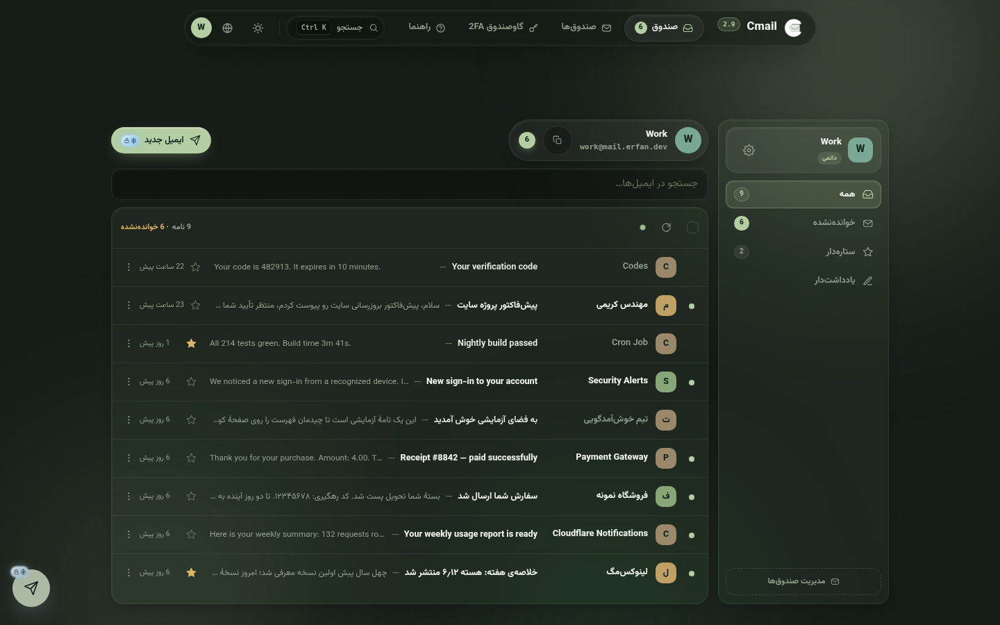 |

| **دایرهٔ حساب‌ها** — تنها محل تعویض حساب، با جزئیات هر حساب قبل از ورود |
|---|
| 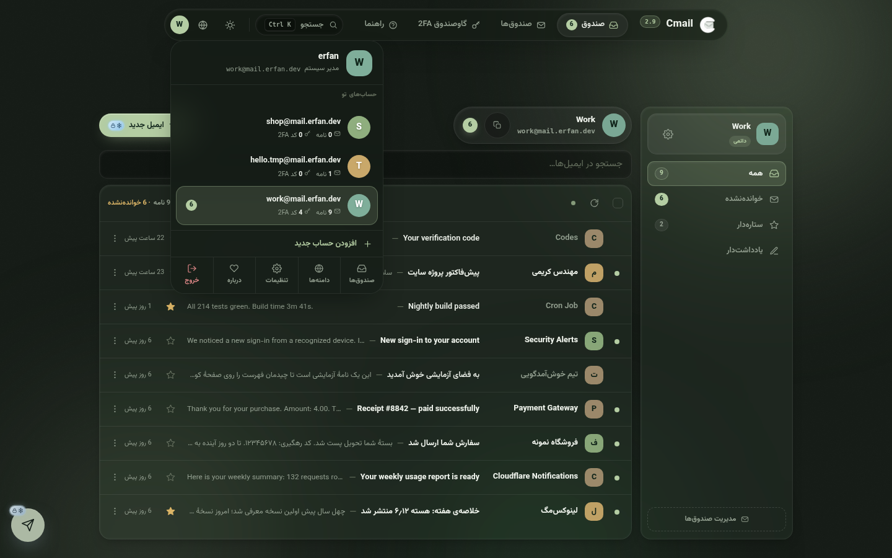 |

| **یک ایمیل، یک صفحه** — آدرس خودش، دکمهٔ بازگشت و نوار اقدامات؛ نه پاپ‌آپ |
|---|
| 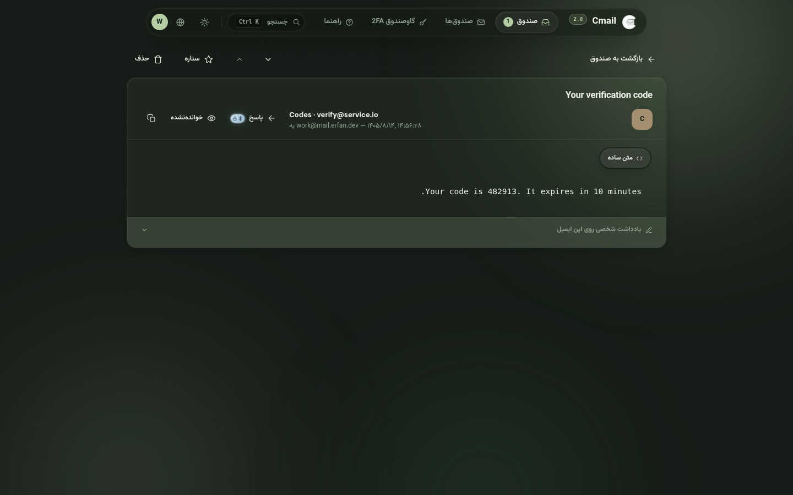 |

| **اتاق فرمان دیتابیس** — اتصال، جدول‌ها، ضربان کرون و جریان ایمیل؛ هر مشکل دکمهٔ ترمیم خودش را دارد |
|---|
| 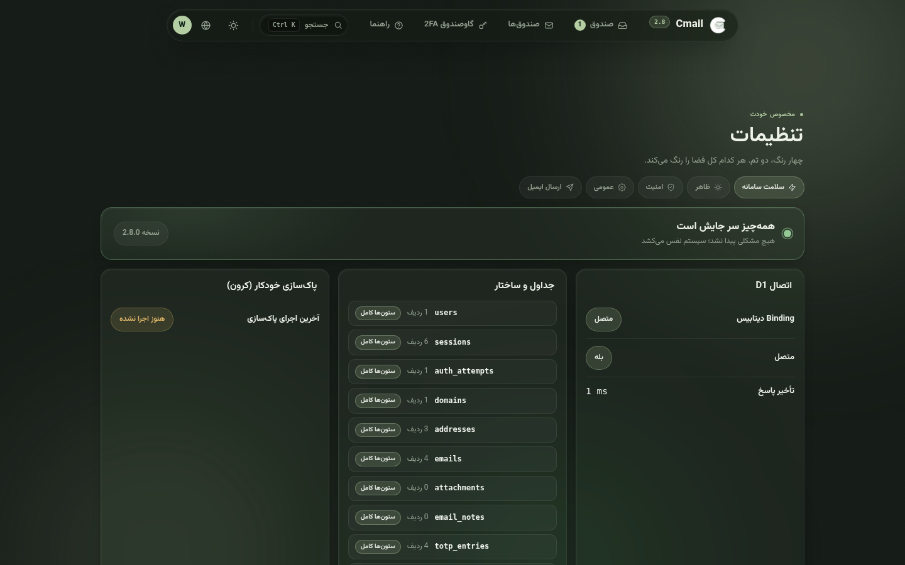 |

| **گاوصندوق هر حساب** — کدهای زنده فقط برای همین حساب، **پوشه‌های چسبیده به همین حساب**؛ آدرس موقت تا تصمیم تو یخ‌زده است |
|---|
| 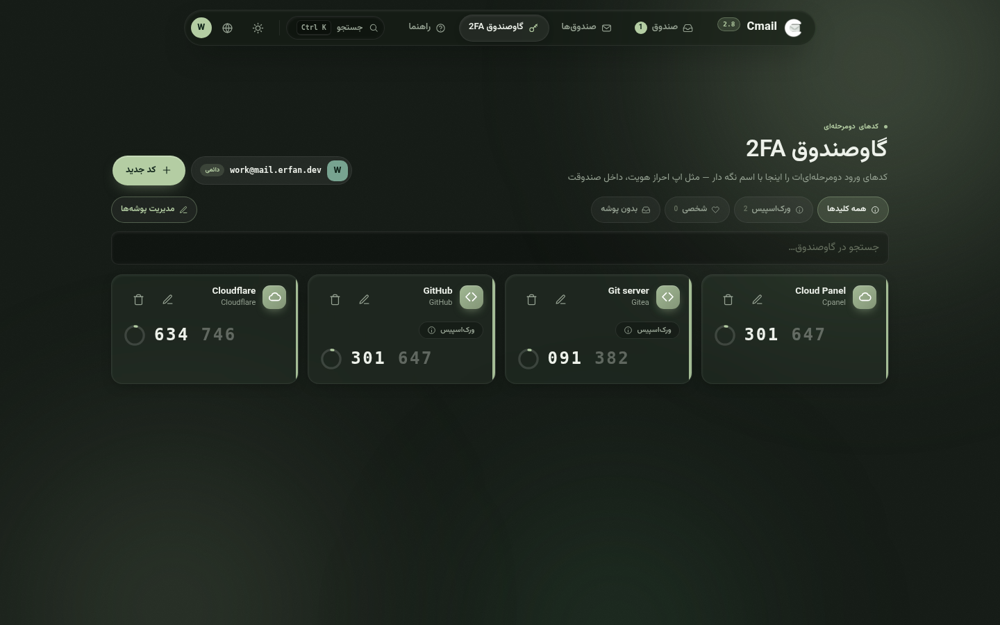 |

| **هر دامنه، یک کارت** — مسیر ثبت، نوار آمار، کلیدهای Active و Catch-all، حلقهٔ ضربان وقتی نامه در جریان است |
|---|
| 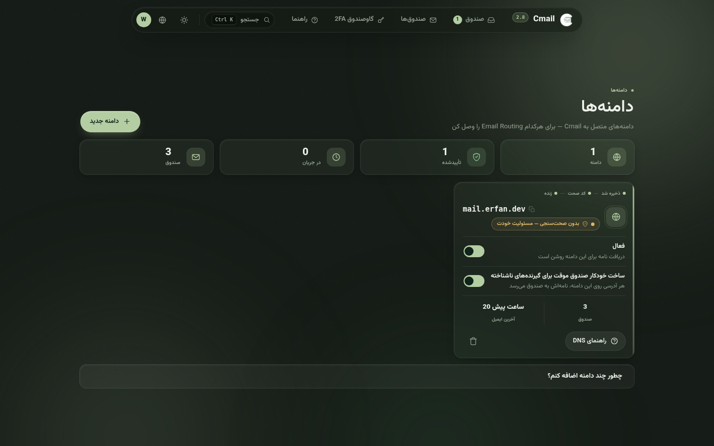 |

| **هر حساب، یک کارت** — نوار آمار، شمارش معکوس انقضا، ورود به صندوق با یک کلیک |
|---|
| 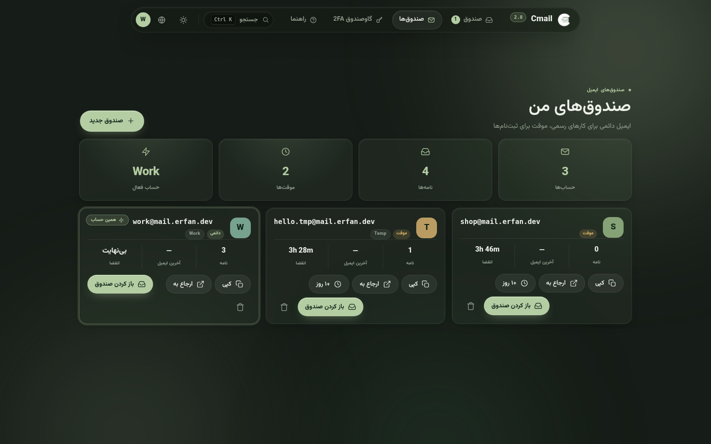 |

| **یک کلید، از هر جا به هر جا** |
|---|
| 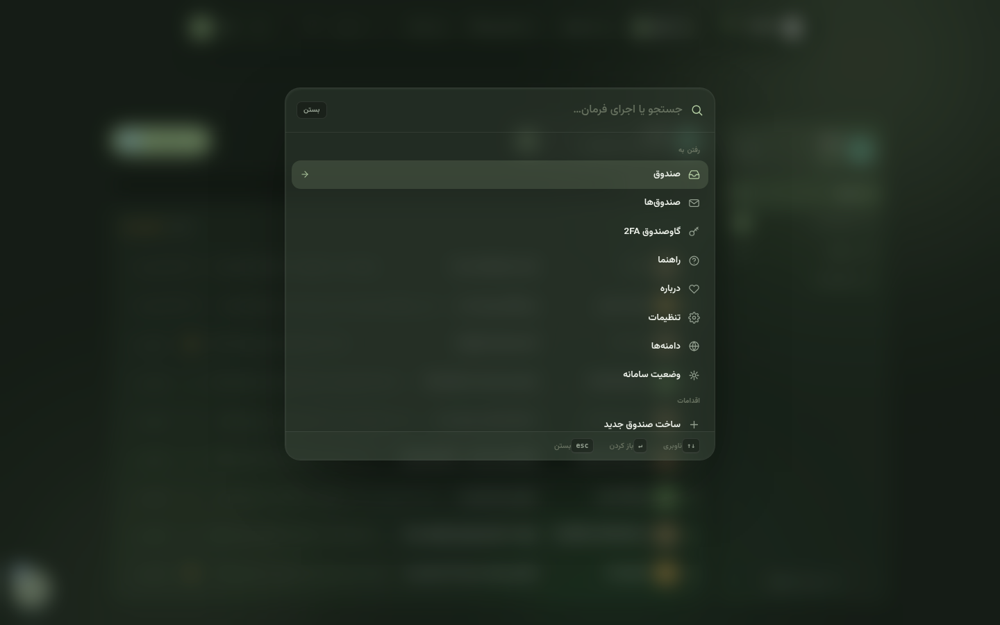 |

| **پوستهٔ روشن** |
|---|
| 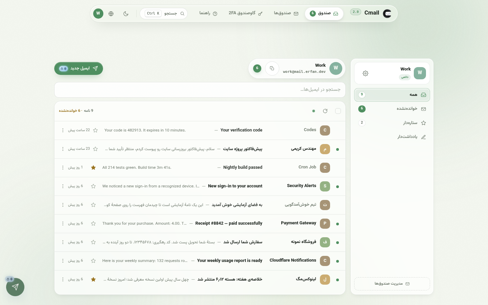 |

| **کل کابین، در جیب پیراهن** |
|---|
| 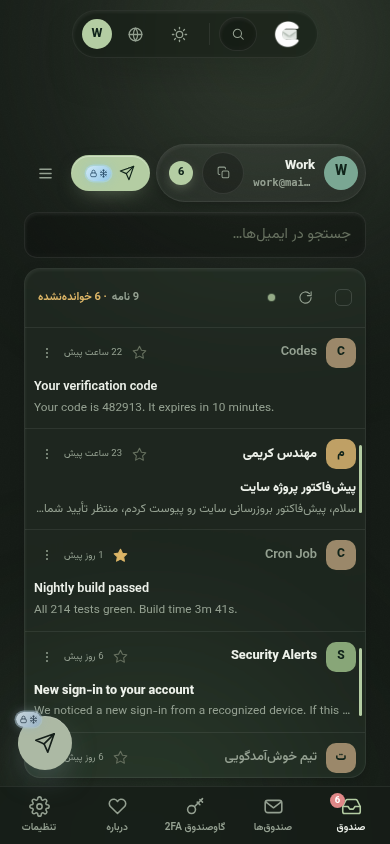 |

| **در ورودی** — کارت وسط‌چین، شفق زنده، راهنمای بازیابی سر جایش |
|---|
| 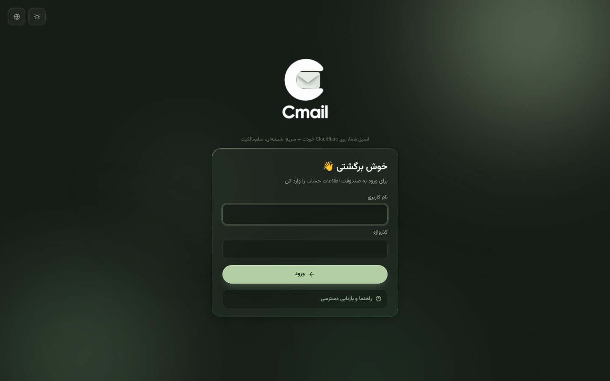 |

| **درباره — کارت سازنده و روبان Climind-W** |
|---|
| 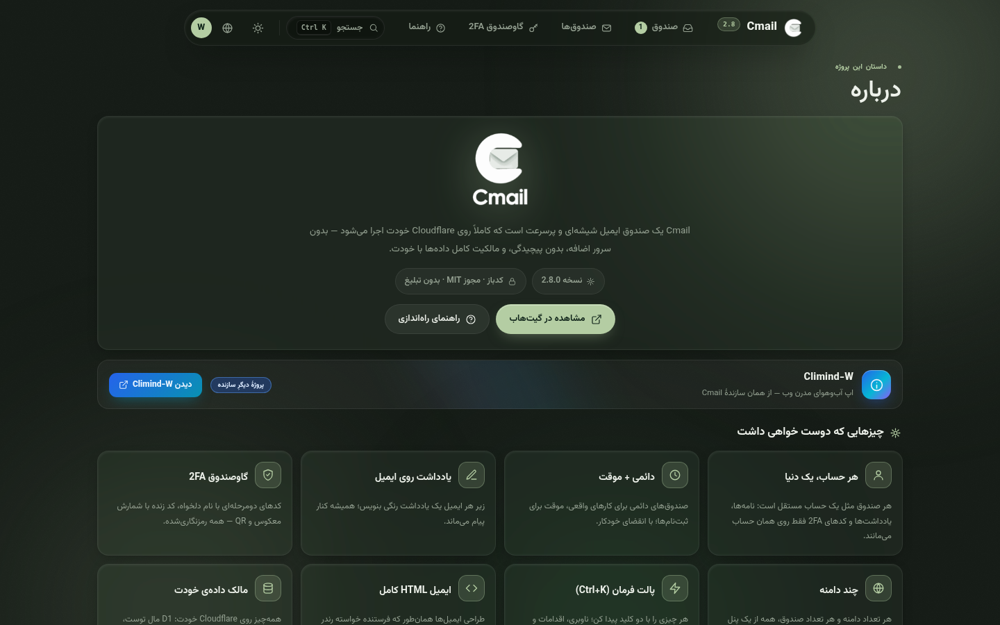 |

</div>

## تازه‌های ۳.۰.۰ — اشتراک‌گذاریِ رها، دو در روی کارت ورود

- **اشتراک‌گذاری رها شد.** سیستم اشتراک‌گذاری به چیزی که همیشه باید می‌بود برگشت: هر دسترسی مهمان حالا می‌تواند **هر تعداد صندوق** را هم‌زمان در خود داشته باشد — نه فقط یکی. یک انتخاب‌گر تازه (یک چیپ برای هر صندوق) در تنظیمات ← اشتراک‌گذاری نشسته؛ مهمان دقیقاً همان صندوق‌هایی را می‌بیند که به او می‌دهی و هیچ‌چیز دیگر از حساب را نمی‌بیند. فهرست، جستجو، ستاره، پوشه‌ها، یادداشت، کارهای گروهی، پیوست‌ها و حتی ارسال (به‌عنوان هر یک از صندوق‌های اشتراکی) همه با دنیای چندصندوقی حرف می‌زنند.
- **تنظیماتی که سیستم قبلی داشت — و چندتای تازه.** هر دسترسی حالا یک **سقف دستگاهِ هم‌زمان** دارد (بی‌محدودیت / ۱ / ۲ / ۳ — مرورگر تازه وقتی اتاق پر است با احترام رد می‌شود) و یک **پیام خوش‌آمد**: یک خط کوتاه که مهمان همان لحظهٔ ورود می‌خواند، مستقیم از مدیرش. اجازه‌ها، انقضا با پیش‌فرض‌ها + تاریخ دقیق، نام کاربری/گذرواژهٔ دلخواه با تاس، حسابرسی زنده (نقطهٔ آنلاین، مرورگرهای داخل، آخرین بازدید)، بیرون‌انداختن، ابطال، حذف کامل — همه هنوز یک پنجره‌اند.
- **کارت ورود با دو در.** صفحهٔ ورود یک کنترل دوبخشیِ باریک دارد: **حساب من** برای مدیر و **ورود اشتراکی** برای مهمان‌ها — دری با نشان خودش که دسترسی اشتراکی را مستقیم به صندوق‌هایش می‌رساند. پیام خوش‌آمد همان ثانیه که مهمان فرود می‌آید می‌پرد؛ و سقف دستگاهِ پر، با جملهٔ روشن حرف می‌زند نه یک خطای عمومی.
- **پنل مهمان، داینامیک آیلند شد.** بنر شلوغِ توضیحات حذف شد. مهمان حالا زیر یک قرص شناورِ مرکزی به سبک اپل زندگی می‌کند: نام صندوق (یا «n صندوق»)، شمارش معکوس زندهٔ روز-ساعت-دقیقه-ثانیه و فقط یک **؟**. زدن **؟** آیلند را با مورف نرم باز می‌کند و فقط چیزهای لازم را می‌دهد — زمان باقی‌ماندهٔ لیبل‌دار، فهرست صندوق‌ها (لمس هر ردیف = کپی آدرس)، پیام مدیر اگر باشد، و خروج. شناور است و صفحه را نمی‌راند، در حالت تعلیق صادقانه عدد ثابت نشان می‌دهد و هر ۲۰ ثانیه بی‌صدا خودش را همگام می‌کند — بدون تکان‌خوردن زیر پنجه.
- **مدیر، اتاق کنترلِ هر دسترسی را دارد.** هر اشتراک حالا یک **فهرست دستگاه‌ها** و یک **فهرست نشست‌ها** دارد — هر مرورگر و هر نشست زنده را ببین و تک‌تک را با یک فشار غیرفعال کن. نام کاربری و گذرواژه همیشه دوباره پیدا می‌شوند (با همان AES-256-GCM گاوصندوق مهر شده‌اند) و **Regenerate** یک جفت نام کاربری/گذرواژهٔ تازه می‌ریزد — با اختیارِ بیرون‌انداختن همهٔ مرورگرهای زندهٔ مهمان در همان نفس.
- **تعلیق، درست انجام شد.** حساب اشتراکی که **هیچ صندوقی به آن اختصاص نیافته** به‌جای حذف‌شدن، خودش معلق می‌شود — دوباره صندوق تعیین کنی، خودبه‌خود بیدار می‌شود (صندوقی که فقط بی‌نامه است هرگز معلق نمی‌شود). هر دسترسی را می‌توانی دستی معلق کنی و انتخاب کنی ساعتش چه شود: **از تایم کم شود** یا **ثابت بماند**. مهمانِ معلق هنوز وارد می‌شود ولی صفحهٔ یخ‌زده جواب می‌دهد و زمان باقی‌مانده را نشان می‌دهد. حذف صندوقی که هنوز به مهمانی اختصاص دارد اول هشدار می‌دهد — چون از او هم جدا می‌شود.
- **یک حقیقت، همه‌جا.** کلیدی که مهمان به صندوق اشتراکی اضافه می‌کند همان ردیفی است که ادمین می‌بیند — کد زنده در هر دو طرف یکی است، و جزئیات حساب (شمارش کدها، صندوق‌ها، هویت) در همهٔ نماها با هم تازه می‌شوند. و مهمان دیگر به درِ گاوصندوق نمی‌خورد: باگ اتصال پارامترهای D1 که همهٔ کوئری‌های گاوصندوقِ مهمان را می‌شکست، از ریشه بسته شد.
- **هیچ چیزِ بی‌مجوزی اصلاً رندر نمی‌شود.** تراشیدن اجازه‌های مهمان از «غیرفعال» به «اصلاً وجود ندارد» رسید: بدون دکمهٔ ارسال، بدون ستاره، بدون حذف، بدون انتخاب گروهی، بدون صفحهٔ تنظیمات، بدون مدیریت پوشه‌ها — و پالت فرمان فقط همان‌ها را می‌شناسد که مهمان حق دارد. آدرس‌دهی مستقیم به `#/settings` یا `#/domains` به‌جای یک ۴۰۳ بعد از رندر، مستقیم به نمای صندوق برمی‌گردد.
- **تمام نمادها زیر ذره‌بین.** همهٔ آیکون‌های برنامه رسیدگی شدند: دو نماد مودال که بی‌سر و صدا به نماد عمومی برمی‌گشتند (`folder` و `users`) حالا آیکون واقعی دارند، فلش‌های متنی پالت فرمان (↑↓) به دو شورون SVG تبدیل شدند که هرگز جعبه‌تخالی نمی‌شوند، راهنمای کیبورد `Enter` و `Ctrl`/`⌘` را با کیپ‌های امن می‌نویسد، و چند ایموجیِ سوار بر عنوان‌ها جایش را به نشان‌های SVG هم‌رنگ تم داد که همه‌جا رندر می‌شوند.
- **نماد اختصاصی حالت قفل، و ماسکوت‌هایی که با حال‌وهوا عوض می‌شوند.** حالت قفل نشان خودش را گرفت — قفلی که جرقه‌ای در سوراخ‌کلیدش است — روی نوارابزار، صفحهٔ قفل و تنظیمات ← امنیت. نگهبانِ صفحهٔ قفل حالا یک **برشِ تمیز و شفاف است که روی شیشه شناور می‌شود** — پلاکِ سفید حذف شد؛ روز سایه‌ای لطیف دارد و شب یک هالهٔ آرامِ هم‌رنگ تم. روبان «درباره» اثر واقعیِ **دوئو Cmail و Climind** را پوشیده — همان تصویر خودِ سازنده، با برش مرتب دور دو کاراکتر — و کاراکتر Climind **خودش را با هر دوازده پالت هم‌رنگ می‌کند**؛ نه با فیلترهای CSS، بلکه با برش‌های ازپیش‌رنگ‌شدهٔ هر پالت (رنگ دقیق تم)، در حالی که ماسکوت Cmail کنارش در همهٔ حالات خودِ خودش می‌ماند. لوگوی برندِ بالای صفحه هم همان نشان کلاسیک همیشگی است: شب سفید، روز سیاه.
- **صندوق، محکم‌تر و خفن‌تر.** ردیف‌های خوانده‌نشده حالا یک نوار باریکِ هم‌رنگ تم و یک ته‌رنگِ لطیف دارند (ساعتشان هم رنگ تم می‌گیرد)، ردیف‌های انتخاب‌شده با رنگ مودال می‌درخشند و نوار عمل‌های گروهی فنری وارد می‌شود. نوارابزار راست می‌گوید: شمارنده‌ها با همان صندوقی می‌خوانند که توش هستید (ارسال‌شده · ستاره‌دار · یک پوشه — نه جمعِ کل حساب)، نامه‌های خروجی دیگر «خوانده‌نشده» حساب نمی‌شوند، عوض‌کردن حساب نوارِ انتخابِ جامانده را جمع می‌کند، پاسخ به نامهٔ خروجیِ خودتان خطاب می‌رود سمتِ گیرنده (نه خودتان)، کلید `/` مستقیم به جست‌وجو می‌پرد و `Esc` پرس‌وجو را پاک می‌کند.
- **دکمهٔ ارسال، سرِ جای درست.** پانویس پنجرهٔ نوشتن حالا یک **ردیفِ ارسال** واقعی است: دکمهٔ ارسال سرِ ردیف است (اولین چیزی که چشم می‌بیند، راست‌چین و چپ‌چین یکسان)، لغوی آرام دنبالش می‌آید و یادداشت پیش‌نویس ته ردیف — دیگر کسی دنبال یک دکمهٔ کوچک در گوشه نمی‌گردد. روی گوشی تمام‌عرض می‌گیرد.
- **یک فایل، از سر تا پا نو.** `worker.js` تک‌فایلی — همان آرتیفکتی که هر مسیر نصب استفاده می‌کند — از همین سورس‌ها با مُهر نسخهٔ **۳.۰.۰** در همه‌جا بازساخته شد: نوارpill، صفحهٔ درباره و نشان نسخه.

<details>
<summary><b>تازه‌های ۲.۹.۵ — پوشه برای هر حساب، صحنه پشت شیشه‌ها</b></summary>


- **پوشه برای هر حساب.** ریل پوشه‌ها یک طبقهٔ دوم گرفت: برای هر حساب پوشه‌های خودت را بساز — هر پوشه یک نقطهٔ رنگی، یک شمارندهٔ زنده و قانون خودش را دارد و هیچ‌وقت نامهٔ دو حساب را قاطی نمی‌کند (همان ایزولاسیون گاوصندوق 2FA). یک نامه را از منوی همان ردیف ببر داخل پوشه؛ یک انتخاب کامل را با نوار «انتقال به پوشه» جابه‌جا کن؛ و به پوشه یک **قانون فرستنده** بده — چند واژهٔ جداشده با ویرگول مثل `news, bills` — تا نامهٔ تازهٔ آن فرستنده‌ها همان لحظهٔ رسیدن، خودش داخل پوشه بنشیند. مدیرِ پوشه‌ها (تغییر نام، رنگ، قانون، حذف) یک دکمهٔ + فاصله دارد؛ حذف پوشه نامه‌هایش را به صندوق اصلی برمی‌گرداند و هیچ‌چیز از دست نمی‌رود.
- **صحنه پشت شیشه‌ها.** تنظیمات ← ظاهر حالا یک گزینندهٔ **پس‌زمینهٔ صحنه** دارد: پنج صحنهٔ دستی‌ساز که پشت همهٔ پنجره‌ها زنده‌اند — **تپه‌های سبز** (یک صبح نوستالژیکِ آفتابی با ابرهای آرام)، **شفق قطبی** (نوارهای سبز-بنفش نفس‌کش روی تاریکی پرستاره)، **غروب** (خورشیدِ کوتاه که در مه گرم فرو می‌رود)، **آسمان شب** (دشتی آرام از ستاره‌های چشمک‌زن) — یا **بدون صحنه** برای اتاق ساده. همه هنرِ دستیِ اورجینال، همه با حرکتِ آرام، و همه همان لحظه که سیستم کاهش‌حرکت بخواهد، می‌ایستند.
- **میزِ نوشتن از نو.** پنجرهٔ ارسال حالا مثل سرویس‌های بزرگ خوانده می‌شود: ردیف‌های هم‌تراز به‌جای برچسب‌های روی‌هم، **متن‌نامه‌ای که با پیام بلندتر می‌شود**، فرستنده با آواتار زنده کنار گزیننده، اشتباه‌ها کنار خودِ فیلد گفته می‌شوند (گیرندهٔ نامعتبر، متن خالی) نه از ته گلوی توست، **دکمهٔ ارسال با چرخانِ خودش**، **Ctrl/Command + Enter** برای شلیک — و **پیش‌نویسی که خودش ذخیره می‌شود** و از بستن تب هم جان به در می‌برد.
- **نصب یک‌کلیکی.** راهنما حالا دکمهٔ رسمی **Deploy to Cloudflare** را دارد: فشارش بده؛ کلادفلر خودش ریپو را کلون می‌کند، دیتابیس D1 خودش را می‌سازد و ورکر را بالا می‌آورد — بعد `/setup` بقیهٔ راه را دستت می‌گیرد. نصب​کنندهٔ ترمینال (`deploy.sh`) هم همچنان همه‌کارهٔ مسیر خط فرمان است و حالا هر دو شکل کانفیگ را می‌شناسد.
- **ایمنیِ کلیک‌های سریع، بلندتر.** بارگذاری پوشه‌ها توکن توالی خودشان را دارند، تعویض حساب مجموعهٔ پوشه‌های حساب قبلی را پیش از رسیدن حساب جدید پاک می‌کند، و هیچ نقاشی‌ای جز داخل نمای زنده اتفاق نمی‌افتد.

</details>

<details>
<summary><b>تازه‌های ۲.۹ — نسخه‌ای که صندوق را مثل سرویس‌های بزرگ از نو ساخت</b></summary>

- **صندوق از صفر ساخته شد.** یک **بیضی هویت** روشن بالای صفحه — چهرهٔ حساب، اسمش و آدرس کاملش با **دکمهٔ کپیِ یک‌لمسی** — بعد کل صندوق در **یک کارتِ زنده**: نوارابزار با چک‌باکس انتخاب‌همه، رفرش و نقطهٔ نفس‌کشِ به‌روزرسانی خودکار؛ و ردیف‌هایی که مثل سرویس‌های بزرگ‌سال، تک‌خطی خوانده می‌شوند: چهره · فرستنده · موضوع — پیش‌نمایش · ستاره · زمان. ردیف نخوانده همان‌جا که چک‌باکس می‌آید یک نقطهٔ کوچک دارد؛ نزدیکش شوی، چک‌باکس جای نقطه می‌نشیند. ستونِ خواندنِ بلااستفاده حذف شد — فهرست صاحبِ تمام‌عرض می‌شود و هر ایمیل همچنان صفحهٔ مستقل خودش را دارد.
- **بارگذاری هرگز دروغ نمی‌گوید.** هر درخواستی که بیشتر از یک چشم‌برهم‌زدن طول بکشد، یک **نوار پیشرفتِ باریک و زنده** بالای صفحه نقاشی می‌کند. وقتی بارِ صندوق خودش کش دار می‌شود، یک نوار وضعیت با چرخان و جملات صادق، حتی وسط به‌روزرسانی پس‌زمینه، پدیدار می‌شود. بارِ شکسته می‌گوید چه شد و دکمهٔ تلاش دوباره می‌دهد؛ پوشهٔ خالی، جستجوی بی‌نتیجه و «حسابی انتخاب نشده» هر کدام حرفِ خودشان را دارند — نه یک خیرگی خاموش.
- **روبانِ درباره، ادب موبایل یاد گرفت.** روی گوشی، نوار Climind-W خودش را مثل یک کارتِ دومردی می‌چیند — نشان و متن بالا، چیپ و دکمه پایین — به‌جای له‌کردن متن در یک نوار باریک؛ و شفقش روی GPU موبایل دیگر نمی‌چرخد.
- **برنامه بالاخره دقیقاً یک بار بوت می‌شود.** این نسخه یک دوبوتی خاموش را لو داد: اسکریپت ورودیِ نسخه‌دار و ایمپورت‌های بدون نسخه، کل پوسته را دو بار بارگذاری می‌کردند — دو روترِ رقیب، دو شنوندهٔ hash، و صندوقی که گاهی داخل نمای جدا‌شده نقاشی می‌شد و هیچ نشان نمی‌داد. همان چهرهٔ واقعی خانوادهٔ باگ «دو بخش همزمان باز می‌شوند» بود. حالا هر ایمپورت همان مُهر نسخهٔ ورودی را دارد — برنامه یک نمونه است، تضمینی.
- **هیرو و نشان نسخهٔ تازه و اسکرین‌شات‌های از نو** برای صندوقِ نو، سوییچر، پالت، حالت روشن و موبایل — هر دو زبان.

</details>

<details>
<summary><b>تازه‌های ۲.۸ — نسخه‌ای که تعویض حساب را تک‌خانه می‌کند</b></summary>

- **تعویض حساب فقط و فقط از دایرهٔ بالای صفحه.** نوار کناری صندوق دیگر فهرست حساب‌ها نیست و چیپ سرستون حالا یک پلاک هویتِ آرام است — فقط می‌گوید این صندوقِ کیست و هرگز جابه‌جا نمی‌کند. زیر پلاک، ریلِ پوشه‌های خودِ همان حساب است: **همه · نخوانده · ستاره‌دار · یادداشت‌دار** با شمارندهٔ زنده — برشِ سمتِ مرورگر، پس جابه‌جایی بین پوشه‌ها آنی است و شمارنده‌ها همیشه دقیق.
- **گاوصندوق 2FA اتاقی برای هر حساب شد — پوشه‌ها هم داخل همین قانون.** چیپ‌های انتخاب حساب از گاوصندوق حذف شدند؛ گاوصندوق همیشه روی حساب فعلی باز می‌شود. پوشه‌ها دیگر کلی نیستند: هر پوشه با تولدش به یک حساب گره می‌خورد (ستون `address_id` در دیتابیس، با ارتقای نرم برای نصب‌های قدیمی)، انتخاب‌گرِ پوشه فقط پوشه‌های همان حساب را نشان می‌دهد و اگر کدی را به حساب دیگری منتقل کنی، پوشهٔ حساب قبلی خودبه‌خود از آن جدا می‌شود. پوشهٔ یک حساب هرگز با کدهای حساب دیگر قاطی نمی‌شود.
- **نشانِ یخ‌زده حالا همراه خودِ حساب هر جا که باشد دیده می‌شود** — کنار حساب موقت در کارت هویتِ نوار کناری، در چیپ هویتِ گاوصندوق، روی دکمهٔ «کد جدید» — برف‌وقفل تا وقتی مجوز مسئولیت نداده‌ای، و شعلهٔ نفس‌کش 🔥 بعد از آن.
- **کلیک‌های پشت‌سرهم بالاخره به ریشهٔ باگ رسیدند.** ادامهٔ ناهمگامِ یک نمای قدیمی می‌توانست از مسیر `getElementById` به DOM نمای تازه دست پیدا و صفحه را دو بار نقاشی کند؛ حالا هر نما فقط داخل گره‌های خودش نقاشی می‌کند و نمای کهنه دست به هیچ‌چیز نمی‌زند. پنجره‌های باز (و شنونده‌های Escape‌شان)، منوهای شناور و پاپ‌آورها لحظهٔ ناوبری جمع می‌شوند — پنجرهٔ باز دیگر به صفحهٔ بعدی روح نمی‌فرستد.
- **تنظیمات از اضافه‌بار خلاص شد:** فیلد «نام سرویس» حذف شد — برنامه از قبل اسم دارد. تب سلامت سامانه نقش مدیر را همین‌جا دوباره چک می‌کند و فایل‌های ظاهر/اسکریپت حالا آدرس نسخه‌دار دارند (`app.css?v=2.8.0`) تا هیچ مرورگری بعد از به‌روزرسانی، اسکریپت کهنه از کشش صدا نزند.
- **صفحهٔ درباره روبانِ هم‌خانواده را پوشید:** یک نوار شفقِ متحرک معرفیِ **Climind-W** — پروژهٔ دیگرِ سازنده — با یک کلیک تا مخزنش.
- **دامنه‌ها نفس می‌کشند:** کارت‌ها زیر نشانگر موس یک هالهٔ شفق زنده می‌گیرند و هر دامنه‌ای که واقعاً نامه می‌گیرد حلقهٔ ضربانِ نرم دور کره‌اش می‌پوشد.
- **هم‌پوشانی موبایل مرد:** نشان «حساب فعال» در صفحهٔ صندوق‌ها حالا عرض خودش را رزرو می‌کند — آدرس‌های بلند دیگر زیرش نمی‌روند.
- **هیرو و نشان نسخهٔ تازه و ۲۴ اسکرین‌شات از نو** — هر نما، هر دو زبان، از بیلد ۲.۸.

</details>

<details>
<summary><b>تازه‌های ۲.۷ — نسخه‌ای که رنگ‌ها را با نام خودشان صدا می‌زند و هر چه را باید، قفل می‌کند</b></summary>

- **پالت‌ها با نام خودِ رنگ. نقطه.** مریم‌گلی، آرامش و بقیهٔ شاعرانگی بازنشسته شدند — انتخاب‌گر حالا می‌گوید **سبز · آبی · بنفش · کهربایی**، و حالت‌های پس‌زمینه هم کاری را که می‌کنند می‌گویند: **متحرک · ساکن · ساده**. انتخاب‌های قدیمی خودکار به رنگ خودشان می‌روند. تعویض پالت همچنان کل اتاق را همان لحظه و بدون رفرش رنگ می‌کند.
- **قفلِ یخ‌زده هر جا که مسئولیت است.** تا وقتی هیچ سرویس ارصالی وصل نیست، دکمهٔ ارسال (سرستون + دکمهٔ شناور) با هواپیمای کاغذی‌اش و یک نشان یخ‌زدهٔ برف‌وقفل روی صحنه می‌ماند — لمسش می‌کنی بگوید چه چیز کم است، نه اینکه بی‌صدا غیبش بزند. دکمهٔ پاسخ در صفحهٔ خواندن هم همین قانون را دارد. سرویس وصل شد، نشان به قفلِ باز تبدیل می‌شود و همه‌چیز کار می‌کند.
- **گاوصندوق آدرس موقت: اول یخ، بعد شعله.** افزودن کد به حساب موقت همان اول قفل است — برف و قفل کنار + معمول. شمارش معکوس حذف را یک بار بپذیری، مجوز برای همان حساب به خاطر سپرده می‌شود: نشان به یک شعلهٔ نفس‌کش 🔥 تبدیل می‌شود، پنجرهٔ مسئولیت دیگر تکرار نمی‌شود، و بقیهٔ حساب‌های موقت مستقل و همچنان یخ‌زده می‌مانند.
- **صندوقی جمع‌وجورتر و آرام‌تر.** ردیف‌ها لاغرتر شدند (آواتار کوچک‌تر، فاصله‌های تنگ‌تر، پیش‌نمایش نزدیک‌تر) — نامهٔ بیشتری در همان فضا، با همان لطافت شیشه‌ای. نفس خودکار صندوق هم حالا هر ۱۰ ثانیه است.
- **کلیک‌های پشت‌سرهم دیگر نمی‌توانند بشکنند.** تب‌های تنظیمات، کارت‌های پالت، فیلترهای صندوق و تعویض حساب همه مقاوم به ریسک شدند: هر رندر ناهمگام توکن می‌گیرد و رندر کهنه کنار می‌رود تا دو بخش همزمان نقاشی نشوند. دابل‌کلیک روی ارسال دیگر دو پنجرهٔ همزمان نمی‌سازد. و منوهای بازشو به یک لایهٔ ثابت روی خود صفحه رفتند — به‌روزرسانی پس‌زمینه هرگز منوی باز را از زیر دستت نمی‌قاپد.
- **نوار کناری فقط وقتی چیزی عوض شده دوباره نقاشی می‌شود**؛ جای اسکرول و هر منوی باز از نفس خودکار سالم می‌ماند.
- **وضعیت که دیده می‌شود:** تنظیمات ارسال با چیپ زندهٔ «ارسال قفل است / ارسال آماده است» باز می‌شود — حالت ایمیل خروجی قبل از خواندن یک فیلد معلوم است.
- **هیرو و نشان نسخهٔ تازه**، انیمیشنی، برای هر دو زبان.

</details>

<details>
<summary><b>تازه‌های ۲.۶ — نسخه‌ای که هر حساب را مثل یک حساب واقعی جدا می‌کند</b></summary>

- **صندوق جمع‌وجور، با چیپ حساب در سرستون.** سرستون صندوق حالا خودِ حساب فعال را نشان می‌دهد — آواتار رنگی، آدرس، نوع حساب و شمار نامه‌ها در یک چیپ. بازش کنی کارت شیشه‌ای همهٔ حساب‌ها با نشانِ نخواندهٔ هرکدام باز می‌شود و همان‌جا، بدون ترک صندوق، بین حساب‌ها جابه‌جا می‌شوی؛ «افزودن حساب جدید» هم همان پایین است.
- **هر حساب، یک کارت.** صفحهٔ صندوق‌ها از جدول خشک به کارت‌های واقعی تبدیل شد: نوار آمار بالا (حساب‌ها · نامه‌ها · موقت‌ها · حساب فعال) و برای هر حساب یک کارت با آواتار، نشان نوع (دائمی/موقت)، سه عدد (نامه‌ها، آخرین نامه، انقضا با شمارش معکوس) و اقدامات (کپی · بازگردانی · +۱ روز · بازکردن صندوق · حذف). کارتِ حساب فعال با حلقهٔ رنگی و نشان «همین حساب» دیده می‌شود.
- **دامنه‌ها خفن شدند.** صفحهٔ دامنه‌ها حالا با نوار آمار (دامنه‌ها · تأییدشده · در جریان · صندوق‌ها) شروع می‌شود و هر دامنه کارت خودش را دارد: مسیر ثبت «ذخیره شد ← کد صحت ← زنده»، نشان وضعیت واقعی (سالم/منتظر نامه/بدون Catch-all/خاموش)، کلیدهای **Active** و **Catch-all** با توضیح یک‌خطی، و اعداد (صندوق‌ها، آخرین نامه) — با همان لطافت شیشه‌ای.
- **گاوصندوق 2FA مال خودِ حساب است.** گاوصندوق روی حساب فعال باز می‌شود، نه روی «همه»؛ کدهای هر حساب از بقیه جدا می‌مانند و دکمهٔ «کد جدید» هم پیش‌فرض به همان حساب وصل می‌شود.
- **قفل گاوصندوق برای آدرس‌های موقت.** دکمهٔ افزودن کد برای آدرس موقت با علامت 🔒 قفل است. تنها راه باز کردنش پنجرهٔ مسئولیت است که دقیقاً می‌گوید: این آدرس تا چند ساعت دیگر حذف می‌شود و هر کدی که به آن وصل کنی همراهش حذف خواهد شد. «می‌پذیرم» بزنی کد اضافه می‌شود؛ نپذیری قفل سر جایش می‌ماند. کارت کدهای متصل به آدرس موقت هم همیشه شمارش معکوس حذف را نشان می‌دهد.
- **باگ‌های ظاهری بسته شدند.** بستن اعلان‌ها با × حالا فقط همان اعلان را تمیز حذف می‌کند و لغو تایمرش هم ضمانت شده است؛ بستن پنجره‌ها با × دیگر شنوندهٔ Escape را پشت سر جا نمی‌گذارد (دیگر فشردن Escape پنجرهٔ بسته‌شده را دوباره اجرا نمی‌کند و صفحه به‌هم نمی‌ریزد)؛ و کلیک‌های پشت‌سرهم روی منو دیگر دو بخش را همزمان باز نمی‌کنند — هر ناوبری توکن می‌گیرد و رندر کهنه در اولین فرصت کنار می‌رود.
- **نشانگر منو سُر می‌خورد.** قرص صفحهٔ فعال حالا یک نشانگر شیشه‌ای واقعی دارد که با فنر نرم از صفحه‌ای به صفحهٔ دیگر حرکت می‌کند — حس تعویض تب در سرویس‌های بزرگ.
- **عکس‌های تازه برای هر دو زبان** از بیلد ۲.۶ — صندوق، کارت حساب‌ها، کارت دامنه‌ها و گاوصندوقِ قفل‌شده.

</details>

<details>
<summary><b>تازه‌های ۲.۵ — نسخه‌ای که مثل سرویس‌های بزرگ کار می‌کند</b></summary>

- **دایرهٔ حساب‌ها.** آواتار بالا-راست حالا یک سوییچر حساب واقعی را باز می‌کند، همان‌طور که از سرویس‌های بزرگ می‌شناسی: تک‌تک صندوق‌ها با جزئیات ریزشان — چند نامه گرفته‌اند، چند کد 2FA دارند، چند نخوانده — به‌علاوهٔ **افزودن حساب جدید** و ردیف مدیریت/تنظیمات/خروج زیرش. یک حساب را بزن تا کل برنامه داخل فضای همان حساب فرود بیاید؛ خود دایره هم رنگ و حرف همان حساب را می‌پوشد.
- **هر ایمیل، صفحهٔ مخصوص خودش.** بازکردن نامه دیگر پاپ‌آپ روی فهرست نیست — به یک صفحهٔ اختصاصی با آدرس خودش (`#/mail/m/:id`) می‌رود: دکمهٔ واقعی **بازگشت به صندوق**، فلش‌های قدیمی‌تر/جدیدتر، نوار کامل اقدامات (پاسخ، ستاره، خوانده‌نشده، حذف) و پنل یادداشت شخصی. یک نامه، یک صفحه، صفر باگ پاپ‌آپی.
- **در هر لحظه یک حساب.** فهرست صندوق‌ها و جریان یکپارچه در یک مدل صادق ادغام شدند: برنامه صندوقِ حسابِ فعال را نشان می‌دهد و جابه‌جایی — از دایره، از نوار کناری یا از پالت فرمان — کل فضا را عوض می‌کند. دیگر برچسب «این نامه به کدام صندوق رسید؟» وجود ندارد.
- **ناوبری قرص شد.** کل پوسته حالا یک قرص شیشه‌ای شناور است: لوگو و نسخه یک‌طرف، چهار صفحه (صندوق · صندوق‌ها · گاوصندوق 2FA · راهنما) وسط، و جستجو/پوسته/زبان/حساب آن‌طرف — دقیقاً چیدمان طرح مرجع.
- **چهار حال‌وهوا، با اسم صادق.** پالت روی همان چهار حال‌وهوایی که واقعاً به کار می‌آیند نشست و انتخاب هرکدام حالا کل اتاق را رنگ می‌کند: پس‌زمینه، تینت شیشه‌ها، اکسنت‌ها، هایلایت‌ها و حتی رنگ خود مرورگر. انتخاب‌های قدیمی خودکار به نزدیک‌ترین حال‌وهوا می‌روند. *(از ۲.۷ نام‌شان خودِ رنگ‌شان است.)*
- **پنل سلامت درِ خودش را خودش باز می‌کند.** نصب‌هایی که از بیلدهای قدیمی ارتقا یافته بودند ممکن بود بی‌سروصدا حقوق مدیر را از دست بدهند (پیش‌فرض ستون نقش) و سلامت سامانه، دامنه‌ها و همهٔ بخش‌های مدیریتی ناپدید شوند. برنامه حالا خودش می‌فهمد و نقش مدیرِ تک‌کاربر را هنگام بوت برمی‌گرداند — پنل همان دوباره ظاهر می‌شود، بدون هیچ SQL.
- **عکس‌های تازه همه‌جا، برای هر زبان**، از بیلد ۲.۵ — با دو صحنهٔ جدید: دایرهٔ حساب‌ها و صفحهٔ اختصاصی ایمیل.

</details>

<details>
<summary><b>تازه‌های ۲.۴</b></summary>

- **پس‌زمینهٔ زنده، مال خودت.** محیط پشت برنامه با رنگ فعال می‌درخشد — رنگ را عوض کن، کل فضا هم‌رنگ می‌شود. سه حالت حضور در تنظیمات → ظاهر. *(از ۲.۷ با نام کارکردی: متحرک، ساکن، ساده.)*
- **صفحهٔ راه‌اندازی بزرگ شد.** فرم‌ها در دسکتاپ در هر اندازهٔ پنجره واقعاً وسط‌اند. دامنه‌ای که وسط کار رهایش کردی با نشان وضعیت و دکمهٔ **ادامهٔ اتصال** همان‌جا می‌ماند — و اضافه‌کردن دوبارهٔ همان دامنه هرگز خطا نیست.
- **نوار کناری پُرگویی را گذاشت گذاشت.** کارت نقل‌قول حذف شد؛ جایش به صندوق‌ها و حساب‌های خودت رسید.
- **کارت سازنده.** صفحهٔ درباره آدمِ پشت پروژه را با یک کارت واقعیِ حلقهٔ گرادیانی معرفی می‌کند.

</details>

<details>
<summary><b>تازه‌های ۲.۳</b></summary>

- **صندوق یکپارچه.** «همهٔ صندوق‌ها» نامه‌های همهٔ میل‌باکس‌ها را در یک فهرست می‌ریزد و هر ردیف نشان کوچکی از صندوق مقصد دارد.
- **صندوق نفس می‌کشد.** هر ۱۵ ثانیه بی‌صدا نامهٔ تازه را چک می‌کند، تازه‌رسیده را هایلایت می‌کند و نشان‌های خوانده‌نشده را تازه نگه می‌دارد.
- **پنل سلامت در تنظیمات.** اتصال D1 با تأخیر لحظه‌ای، هر جدول با تعداد ردیف و وضعیت ستون‌هایش، ضربان کرون، و جریان ایمیل با فهرست بررسیِ «نامه نمی‌رسی؟».
- **مشکل‌های جدی بالای صفحه ظاهر می‌شوند.** بنری با زبان آدمیزاد بالای برنامه می‌آید و راه‌حلش یک دکمه است.
- **دریافت ایمیل در برابر ناسازگاری مقاوم شد.** هندلر با هر شکلی از دیتابیس کنار می‌آید و تحویل را متوقف نمی‌کند — و پنل سلامت ناسازگاری را نشانه‌گذاری می‌کند.

</details>

## برای چه کسی است؟

- **هرکس از اسپم خسته است** — برای هر ثبت‌نام یک آدرس یک‌ساعته بساز و صندوق واقعی‌ات تمیز بماند.
- **برنامه‌نویس‌ها و تسترها** — ده‌ها صندوق تست بساز، ایمیل‌های سیستمی را بگیر، تمام که شد بگذار منقضی شوند.
- **آدم‌های حرمت‌خصوصی** — بدون آنالیتیکس، بدون اسکریپت ثالث؛ همه‌چیز در حسابت است، زیر کلیدهای خودت.
- **صاحبان دامنه** — دامنه‌هایی که همین حالا روی Cloudflare نشسته‌اند را به یک اکوسیستم کامل ایمیل تبدیل کن؛ با یک ویزارد واقعی، نه دانش سینه‌به‌سینه.
- **هرکس می‌خواهد ابزارش واقعاً مال خودش باشد** — یک بار راه بینداز، برای همیشه مالک باش.

## دانلود — بدون کلون کردن

- **[`worker.js`](https://github.com/Erfan-8910/Cmail/releases/download/v3.0.0/worker.js) آماده** — کل برنامه در یک فایل (حدود ۱٫۳ مگابایت، ~۴۷۰ کیلوبایت gzip). برای نصب گرافیکی همین یک فایل کافی است.
- **بستهٔ کامل v2.9.5:** [`CMail-v3.0.0.zip`](https://github.com/Erfan-8910/Cmail/releases/download/v3.0.0/CMail-v3.0.0.zip) — سورس‌ها، [`schema.sql`](schema.sql)، [`migrations/`](migrations) و اسکریپت‌ها.
- همهٔ نسخه‌ها: [Releases](https://github.com/Erfan-8910/Cmail/releases)
- فقط شکل دیتابیس را می‌خواهی؟ یک فایل است: [`schema.sql`](schema.sql) — آمادهٔ کنسول و قابل اجرای دوباره.

## راهنماها — برای هر زبان

| | نصب | استفاده |
|---|---|---|
| **فارسی** | [راهنمای نصب](docs/DEPLOY.fa.md) | [راهنمای استفاده](docs/USAGE.fa.md) |
| **English** | [Deployment](docs/DEPLOY.md) | [Usage](docs/USAGE.md) |

## کل سیستم در یک نگاه

```
                     ┌──────────────────────────────────────────┐
                     │               Cloudflare                  │
 incoming mail       │                                           │
 SMTP ──────────►  Email Routing (MX)                            │
                     │        │ catch-all                        │
                     │        ▼                                  │
 browser ────────►  Worker ── serves embedded UI (single file)   │
                     │   │  │                                    │
                     │   │  └── Brevo / Resend ──► outgoing mail │
                     │   ▼                                       │
                     │  D1 (SQLite) — mail · inboxes · account   │
                     │               · notes · TOTP · settings   │
                     └──────────────────────────────────────────┘
```

یک Worker رابط کاربری، API، هندلر ایمیل ورودی و پاک‌سازی ساعتی را سرو می‌کند. یک دیتابیس D1 همه‌چیز را نگه می‌دارد. رابط کاربری بخشی از باندل Worker است، پس دیپلوی اتمی است: یک فایل جای‌گذاری کن، رابط و بک‌اند همیشه با هم هم‌نسخه‌اند.

**فقط ذخیره نیست؛ مهروموم شده.** هر رمز 2FA قبل از رسیدن به دیتابیس با AES-256-GCM رمزنگاری می‌شود، رمزها از PBKDF2 با ۱۰۰٬۰۰۰ دور و نمک اختصاصی می‌گذرند، نشست‌ها توکن امضاشده‌اند و ایمیل HTML رندرشده داخل قاب سندباکس و بدون اسکریپت زندگی می‌کند. رمزنگاری اینجا تیکِ چک‌لیست نیست — جنسِ همان چیزی است که گاوصندوق از آن ساخته شده.

**ساخته‌شده برای روز بد** — هندلر ایمیل ورودی روی دیتابیس‌های قدیمی به‌جای برگشت‌زدن نامه‌ها، محتاطانه عقب می‌نشیند و تحویل را ادامه می‌دهد؛ هر کرش به یک صفحهٔ راهنمای دوزبانه تبدیل می‌شود نه یک خطای خام؛ و پنل سلامت فرق «همه‌چیز مرتب است» با «این دقیقاً همان چیزی است که باید بزنی» را می‌داند.

## مجوز

GPL-3.0 © [Erfan-8910](https://github.com/Erfan-8910) — سی‌میل نرم‌افزار آزاد تحت [مجوز عمومی همگانی گنو نسخهٔ ۳](LICENSE) است: استفاده کن، بخوان، تغییرش بده، به‌اشتراک بگذار.

---

<div align="center" dir="rtl">

[](https://github.com/Erfan-8910/Climind-W)

**[Climind-W](https://github.com/Erfan-8910/Climind-W)** — اپ آب‌وهوای مدرن وب، با همان وسواس شیشه‌ای.
همان دست، همان سلیقه — یک ستاره مهمانش کن.

</div>

---

<div align="center" dir="rtl">

**Cmail** — *صندوق خودت، قانون خودت.*

[راهنمای نصب](docs/DEPLOY.fa.md) · [راهنمای استفاده](docs/USAGE.fa.md) · [نسخه‌ها](https://github.com/Erfan-8910/Cmail/releases) · [Climind-W](https://github.com/Erfan-8910/Climind-W) · [English](README.md)

</div>
