<div align="center">


# Cmail

[](https://github.com/Erfan-8910/Cmail/releases)
[](https://workers.cloudflare.com)
[](#the-whole-system-one-diagram)
[](LICENSE)
[](https://deploy.workers.cloudflare.com/?url=https://github.com/Erfan-8910/Cmail)

**A complete mail ecosystem that lives entirely inside your own Cloudflare account — one worker file, one database, zero servers, zero monthly bills.**

[Deploy guide](docs/DEPLOY.md) · [Usage guide](docs/USAGE.md) · [Releases](https://github.com/Erfan-8910/Cmail/releases) · [فارسی](README.fa.md)

</div>

---

## What is Cmail?

Cmail answers a simple question: **why pay rent for a mailbox?**

The whole ecosystem runs inside the Cloudflare account you already own. Incoming mail arrives through **Email Routing**, everything is stored in **D1** (SQLite at the edge), and the entire interface — pages, styles, scripts, fonts, icons — is served by a **single Worker file**. There is no server to babysit, no database to tune, no panel subscription, and nothing that can be taken away from you.

What you get is a personal mail space you genuinely own: the domain, the data, the keys. Burner addresses for signups, permanent boxes for real work, a colored note under any message, a built-in 2FA vault, outgoing mail from your own domain — all in one liquid-glass panel that speaks Persian and English.

## The feature wall

| | |
|---|---|
| ⭕ **The account circle — the only switcher** | Every mailbox is its own account. The circle at the top of the page is the one and only place accounts switch — each account shows its tiny details before you even enter: how many mails it received, how many 2FA codes it holds, what's unread. Add another account from the same panel. Nothing inside the inbox, the sidebar or the folders ever jumps accounts by accident. |
| 📂 **The identity oval and the one big card** | The inbox reads the way a grown-up mail client reads: the account's **identity oval** — its face, its name and its full address with a one-tap copy button — sits above one living card that holds the entire mailbox. A toolbar with a select-all box, a refresh and a breathing auto-refresh dot; single-line rows (face · sender · subject — preview · star · time); the folder rail beside it with **All · Unread · Starred · Noted** and live counts — plus **your own folders per account**, each with a color dot, a counter and an optional sender rule that files incoming mail by itself. |
| 📄 **Every email gets its own page** | Opening a message navigates to a real page of its own — its own URL, its own back button, older/newer arrows — never a popup floating over your list. HTML mail renders sanitized inside a sandboxed frame; plain text has its own toggle. |
| ⏱️ **The inbox breathes on its own** | Every 10 seconds the inbox quietly pulls for new mail, highlights what just landed and syncs the unread badges — no refresh button rituals. And nothing loads in silence: a thin living progress bar rides the top of the page the moment anything drags, and the inbox's own status strip says what is happening. |
| 🩺 **System health, on stage** | A full health report in Settings: D1 connection with live latency, every table with its row count and column state, the cron heartbeat, and the mail flow — each with its own fix button. |
| 🚨 **Problems announce themselves** | When something serious breaks — D1 unreachable, tables missing, schema outdated, mail stalled — a banner appears above the app with the cause and the one-press fix. You hear it from your app first, never from a broken inbox. |
| 🌐 **Domain connect wizard** | Add a domain and it takes your hand: a crisp connect guide, then a verification code you mail to your own domain. The screen re-checks itself every few seconds until the loop proves itself — and mailboxes unlock. Walked away mid-way? The draft waits in the setup screen and on the domains page with a **Continue** button — nobody ever retypes a domain. |
| 🏞️ **Scenes behind the glass** | Pick a living backdrop for the whole app: **Green hills** with drifting clouds, **Aurora** ribbons over a starry dark, a warm **Dusk**, or a quiet **Starry night** — five stages, all hand-drawn, all animated gently, all gone the instant your system asks for reduced motion. |
| 🎨 **A room that matches your color** | The whole environment repaints with the palette you pick — **Green · Blue · Purple · Amber**, each named after its actual color, each one re-tinting the background glow, the glass and every accent in one breath. Three presence modes — **Animated**, **Still**, **Plain** — pick how much life the background has. |
| 🔎 **D1 inspector** | The setup screen lists every expected table with its row count; build the missing ones with a button, drop the strays, keep your database honest. The health tab carries the same inspector, forever. |
| 🗒️ **Notes on emails** | A colored personal note under any message — order numbers, tracking links, anything. Search finds it instantly. |
| 👤 **Every inbox is an account** | Each mailbox behaves like a standalone account: its mail, its private notes and its own 2FA codes stay inside that space. |
| 🔐 **2FA vault — account by account** | A built-in authenticator: live 6-digit codes with a countdown ring, sealed with AES-256-GCM, 77 built-in marks. The vault always opens on the account you are in — and **folders belong to one account each**, so account B's groupings can never swallow account A's keys. |
| ❄️ **Frozen until you decide** | The compose button and the temp-address vault wear an icy snowflake-and-padlock badge while their authorization is missing — the logo stays, the badge tells the truth. Grant the responsibility once and the badge flips to an open flame; the dialog never asks twice. |
| 🤝 **Share a mailbox — or five** | Hand anyone a guest credential for **as many mailboxes as you pick**: its own username/password (always viewable again, **Regenerate** rolls a fresh pair), a permission list (read · star · archive · delete · send · notes), an expiry with presets, a device cap, even a welcome note the guest reads on arrival. Every credential carries its own **device list** and **session list** — disable any of them on the spot — plus live audit, one-press kick, instant revoke and a manual suspension switch with a **freeze-time / keep-counting** choice. Guests sign in through the **Shared access** door on the login card, live under a compact **Dynamic Island**, and see nothing but what you handed over — unauthorized controls never render at all. |
| 🛡️ **Account 2FA** | Signing in itself can be protected with TOTP. |
| 📤 **Outgoing mail — optional** | Connect Brevo or Resend with one API key and send from your own domain, with a real test probe. It never gates the rest of the app. |
| ⌘ **Command palette** | Press <kbd>Ctrl/⌘</kbd>+<kbd>K</kbd> anywhere: jump to anything, run actions, search mail live as you type. |
| 🧹 **Auto-cleanup** | An hourly cron expires temporary inboxes and purges old mail — and its heartbeat shows up in the health tab. |
| 🌙 **Liquid-glass UI** | Dark & Daylight themes, 4 color palettes named by their color, background presence modes, Persian (RTL) + English. |
| 📱 **Truly responsive** | From a 320px phone to a 1920px desktop — panes fold into drawers and bottom sheets. |
| 🔒 **Your data, your rules** | Your D1, your keys, your domain. Nobody else holds your mail. |

## The gallery

<div align="center">

| **The cockpit** — the identity oval (name + address + copy) above one living card; single-line rows, folder rail with live counts |
|---|
| 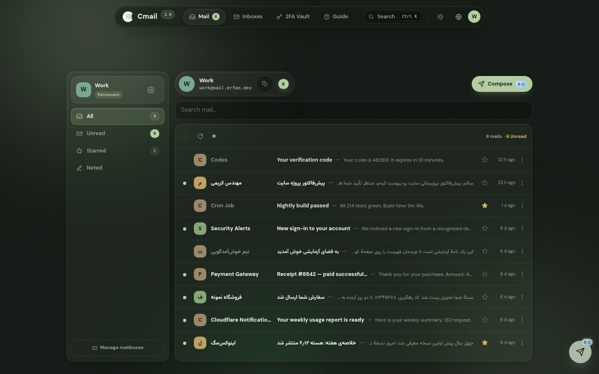 |

| **The account circle** — the one and only place accounts switch, with each account's details before you even enter |
|---|
| 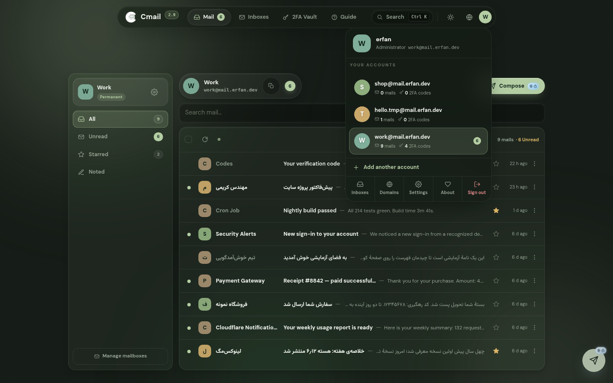 |

| **One email, one page** — its own URL, back button and action bar; never a popup |
|---|
| 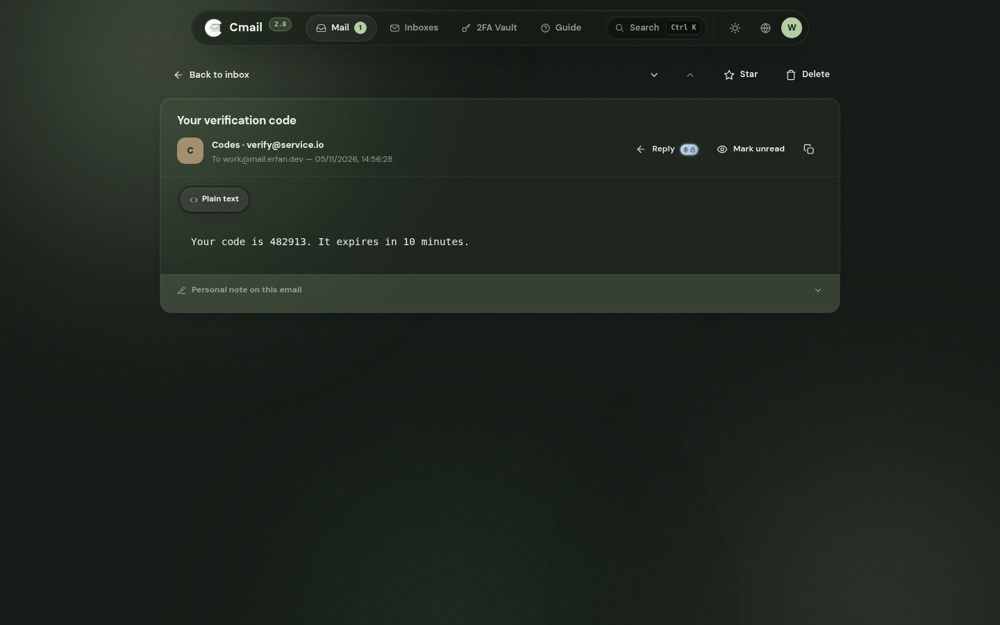 |

| **Mission control for your database** — connection, tables, cron heartbeat, mail flow; every problem carries its own fix button |
|---|
| 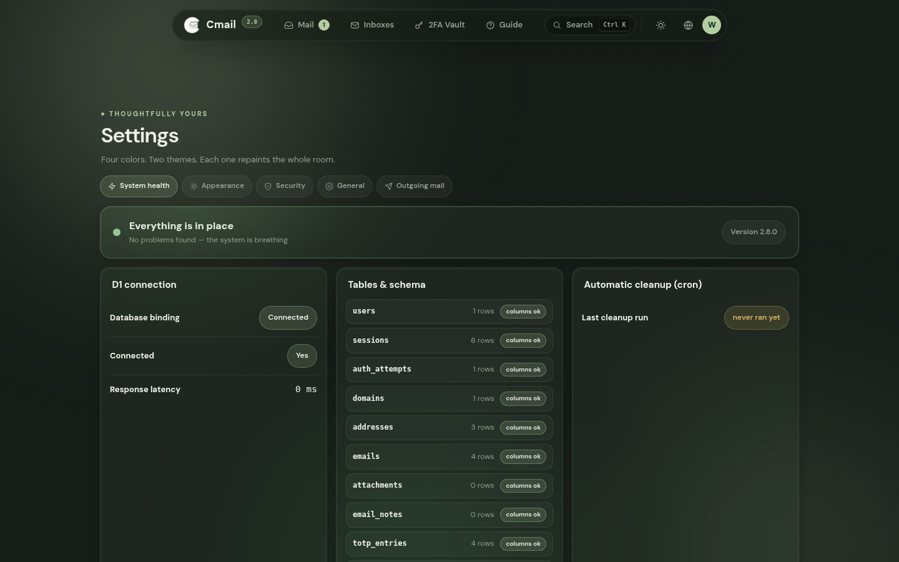 |

| **The account's own vault** — live codes scoped per account, **folders bound to that account**; temp addresses wear the frozen badge until you decide |
|---|
| 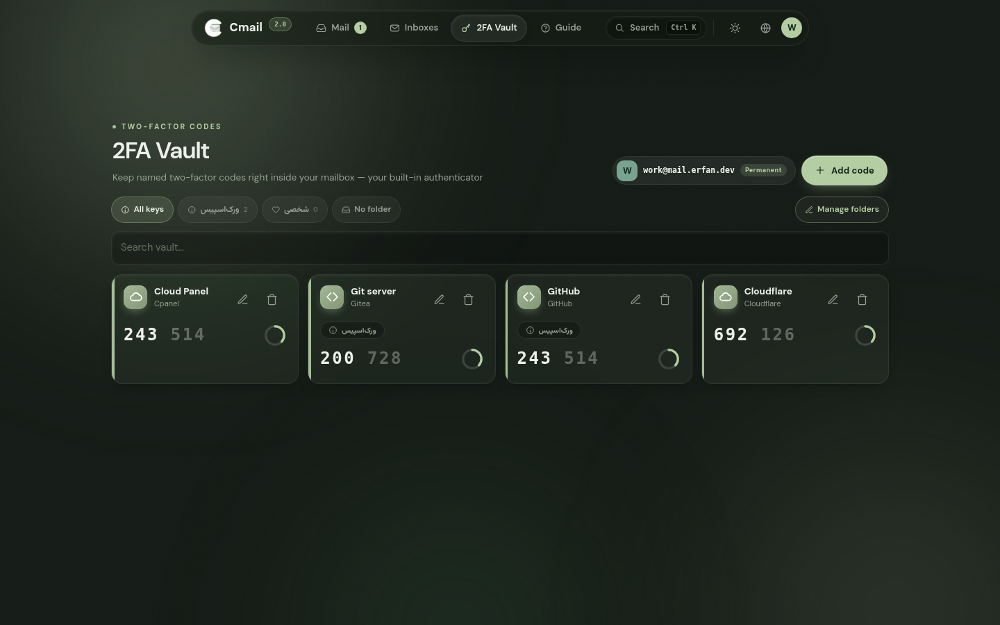 |

| **Every domain, one card** — lifecycle trail, stat strip, Active & Catch-all keys, a heartbeat ring when mail is flowing |
|---|
| 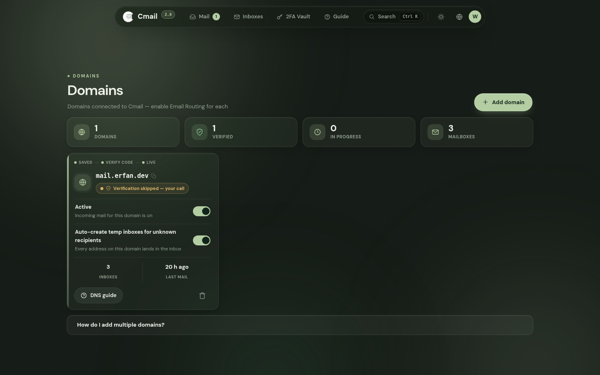 |

| **One account, one card** — stat strip, expiry countdown, one-click entry |
|---|
| 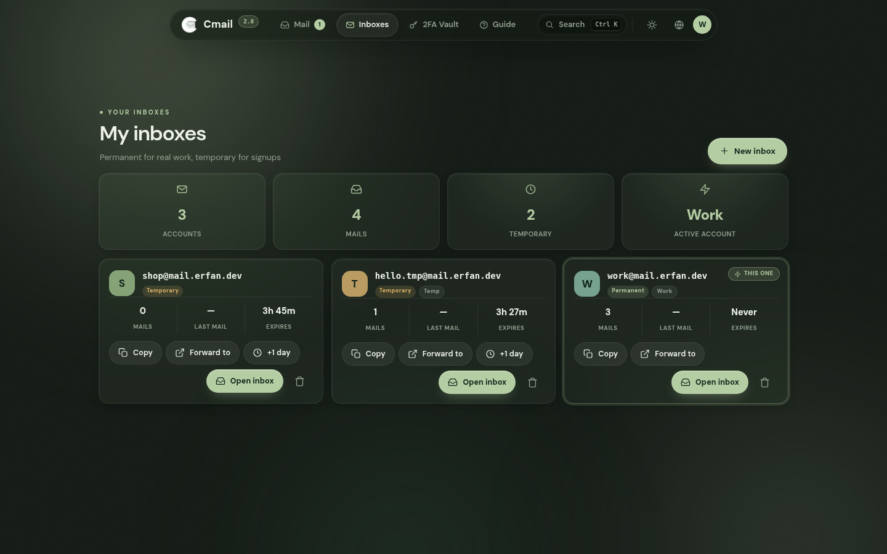 |

| **One keystroke from anywhere to everywhere** |
|---|
| 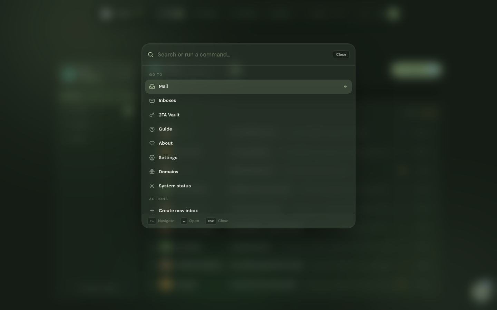 |

| **Daylight mode** |
|---|
| 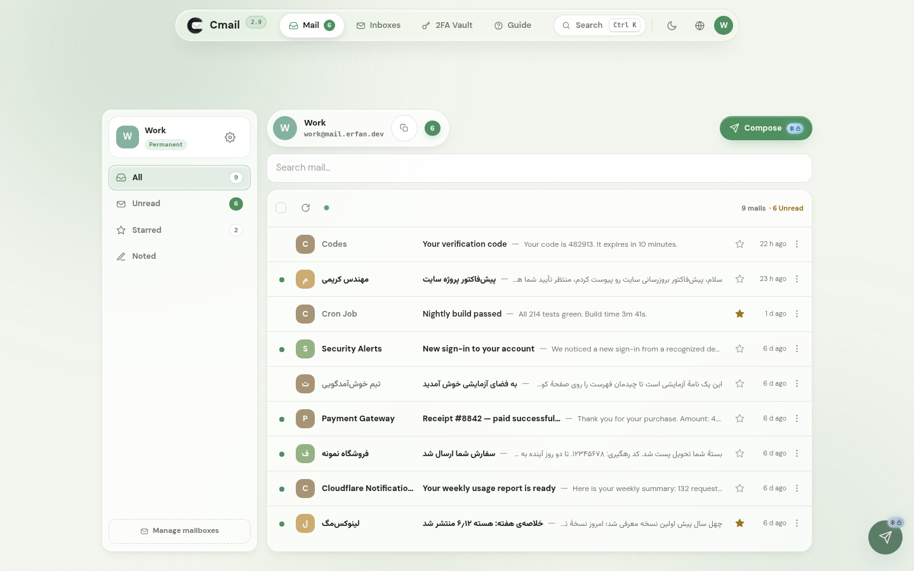 |

| **The whole cockpit, in a shirt pocket** |
|---|
| 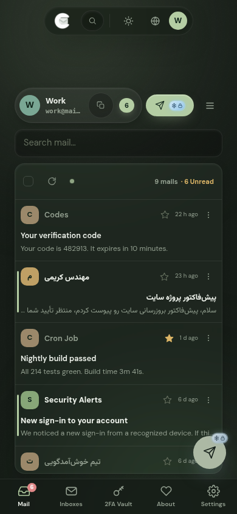 |

| **The front door** — centered card, living aurora, recovery guide built in |
|---|
| 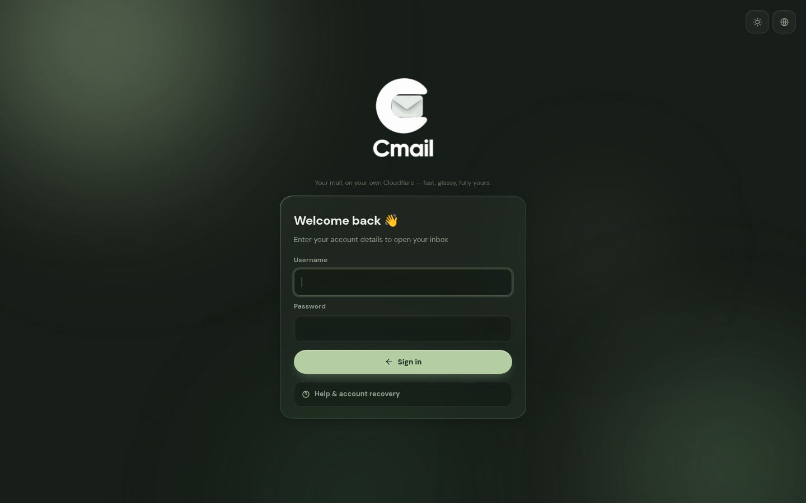 |

| **About — the maker card and the Climind-W ribbon** |
|---|
| 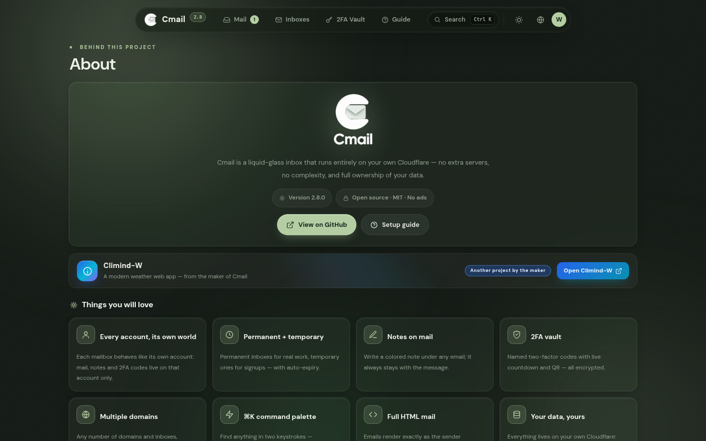 |

</div>

## What's new in 3.0.0 — sharing unleashed, two doors on the sign-in card

- **Sharing, unleashed.** The share system grows back into what it was always meant to be: one guest credential can now hold **as many mailboxes as you like** — not just one. A brand-new mailbox picker (one chip per mailbox) lives in Settings → Sharing; the guest sees exactly the mailboxes you hand over and nothing else of the account. The list, search, star, folders, notes, bulk actions, attachments and even sending (as any one of the shared addresses) all speak the new multi-mailbox world.
- **The settings the old system had — and then some.** Every credential now carries a **simultaneous device cap** (unlimited / 1 / 2 / 3 — the newest browser politely refuses when the room is full) and a **welcome note**: a short line the guest reads the moment it lands, straight from its admin. Perms, expiry presets + exact date, custom username/password with the dice, live audit (online dot, browsers inside, last seen), kick, revoke, hard delete — all still one pane.
- **A sign-in card with two doors.** The login page wears a slim segmented control: **My account** for the owner, **Shared access** (بخش ورود اشتراکی) for guests — a clearly marked door with its own sigil that signs a shared credential straight into its mailboxes. The welcome note pops the second a guest lands; a full device cap says so in plain words instead of a generic error.
- **The guest panel became a Dynamic Island.** The busy explainer banner is gone. A guest now lives under one floating central pill, Apple-style: the mailbox name (or "n mailboxes"), a live D-H-M-S countdown and a single **?**. Tapping **?** morphs the island open with nothing but the essentials — labeled time remaining, the mailbox list (tap a row to copy), the admin's note if there is one, and sign-out. It floats instead of pushing your page around, shows a frozen honest number while suspended, and re-syncs itself quietly every 20 seconds without jumping under your cursor.
- **The admin got a control room for every credential.** Each share now carries a **device list** and a **session list** — see every browser and every live session and disable any of them with one press. Username and password are always lookable again (sealed AES-256-GCM, same vault as TOTP), and **Regenerate** rolls a fresh username/password pair, optionally signing out every live guest browser in the same breath.
- **Suspension, done properly.** A shared account with **no mailbox assigned** suspends itself instead of being deleted — assign a mailbox again and it wakes up on its own (an inbox merely empty of mail never suspends). You can suspend any credential manually and choose what its clock does: **keep counting down** or **freeze time**. The suspended guest still signs in but a frozen page answers, showing the remaining time. Deleting a mailbox that is still assigned to guests warns you first — because it leaves them too.
- **One truth, everywhere.** A 2FA key a guest adds to a shared mailbox is the same row the admin sees — the live code is identical on both sides, and account details (code counts, mailboxes, identity) refresh together in every view. And guests no longer stumble at the vault's door: the D1 parameter-binding bug that broke every guest vault query is fixed at the root.
- **Nothing unauthorized ever renders.** Guest permission-trimming went from "disabled" to "does not exist": no compose button, no star, no delete, no bulk selection, no settings pages, no manage-folders — and the command palette only knows what the guest may do. Hard-navigating to `#/settings` or `#/domains` folds straight back to the mail view instead of serving a 403 after the fact.
- **Every icon audited, every glyph replaced.** The whole app's symbols went under the magnifier: the two modal icons that silently fell back to a generic mark (`folder`, `users`) now have real icons, the command palette's text arrows (↑↓) became crisp SVG chevrons that can never turn into tofu boxes, keyboard guides spell `Enter` and `Ctrl`/`⌘` in ASCII-safe keycaps, and the handful of emoji riding in titles gave way to theme-tinted SVG marks that render everywhere.
- **A dedicated mark for Lock mode, and mascots that follow the mood.** Lock mode earned its own icon — a padlock with a spark in its keyhole — on the toolbar, the lock screen and Settings → Security. The lock screen's guard is now a **clean cutout that floats on the glass** — the white sticker plate is gone; daylight carries a soft shadow, night adds a quiet accent halo. The About ribbon wears the real **Cmail + Climind duo** — the maker's own artwork, trimmed to the two characters with an even margin — and the Climind fellow **re-tints himself into all twelve palettes** through pre-built per-palette cutouts (exact accent hues, no muddy CSS filters), while the Cmail mascot beside him stays exactly himself. The top bar's brand mark stays the classic glyph it always was: white by night, black by day.
- **The inbox, tightened.** Unread rows now carry a slim accent bar and a faint tint (their time stamp turns accent too), selected rows glow in the mood's color, and the bulk bar springs in. The toolbar tells the truth: counters match the box you are actually in (sent · starred · a folder — not the account totals), outgoing mail no longer counts as unread, switching accounts retires a leftover selection bar, replying to your own sent mail addresses the recipient (never you), `/` jumps straight to search and `Esc` wipes the query.
- **The send button, repositioned.** The compose footer is now a real **send row**: the send button leads it (the first thing the eye meets, RTL and LTR alike), the quiet cancel follows, the draft note trails at the far end — no more hunting a small send key in the corner. On phones it takes the full width.
- **One file, updated end to end.** The single-file `worker.js` — the artifact every deployment path uses — is rebuilt from these sources with the version stamped **3.0.0** everywhere: the pillbar, the About page, the badge.

<details>
<summary><b>What 2.9.5 changed — folders on every account, scenes behind the glass</b></summary>


- **Folders on every account.** The folder rail grew a second story: create your own folders **per account** — each folder wears a color dot, holds its own counter, and never mixes two accounts' mail (the same isolation the 2FA vault follows). File a message from its row menu, file a whole selection with the bulk **Move to folder** bar, and give a folder a **sender rule** — comma-separated fragments like `news, bills` — so incoming mail from those senders files itself the moment it lands. The manager (rename, recolor, rule, delete) lives one plus-button away; deleting a folder returns its mail to the plain inbox, nothing is lost.
- **Scenes behind the glass.** Settings → Appearance gained a **Background scene** picker: five hand-drawn stages that live behind every panel — **Green hills** (a clear nostalgic morning over soft rises, with slow-drifting clouds), **Aurora** (green-violet ribbons breathing over a starry dark), **Dusk** (a low sun sinking into warm haze), **Starry night** (a quiet field of twinkling stars) — or **No scene** for the plain room. All original art, all animated gently, all frozen the moment your system asks for reduced motion.
- **The writing table, rebuilt.** The compose window now reads like the big clients': inline rows instead of stacked labels, a **body that grows with the message**, the sender shown as a live avatar beside the picker, mistakes said next to the field (invalid recipient, empty body) instead of shouted from a toast, a **send button with its own spinner**, **Ctrl/Command + Enter** to fire — and a **draft that saves itself** and survives a closed tab.
- **One-click deploy.** The README now carries the official **Deploy to Cloudflare** button: press it, and Cloudflare clones the repo, provisions its own D1 database and ships the Worker — then `/setup` walks you through the rest. The terminal installer (`deploy.sh`) still does the whole job for the command-line route, and now understands both config shapes.
- **Rapid-fire safety, extended.** Folder loads race-protect with their own sequence tokens, folder switches clear the previous account's set before the new one lands, and the drawer/status machinery only ever paints into the live view.

</details>

<details>
<summary><b>What 2.9 changed — the release that rebuilds the inbox like the big clients</b></summary>

- **The inbox is rebuilt from zero.** One clear **identity oval** up top — the account's face, its name and its full address with a **one-tap copy button** — then the whole mailbox in **one living card**: a toolbar with a select-all box, a refresh and a breathing auto-refresh dot, and rows that read on a single line, the way grown-up mail clients read: face · sender · subject — preview · star · time. Unread rows show a little dot where the checkbox would be; reach for the row and the checkbox takes its place. The wasted reading column is gone — the list owns the full width, and every email still opens on its own dedicated page.
- **Loading never lies.** Any request that runs longer than a blink paints a **thin living progress bar** at the very top of the page. When the inbox's own load drags on, a status strip with a spinner and honest words slides in — even during a background refresh. A failed load says what happened and offers a retry; an empty folder, a fruitless search and a missing mailbox each get their own words instead of a blank stare.
- **The About ribbon learned mobile manners.** On phones the Climind-W band lays itself out as a proper two-row card — mark and text up top, chip and button below — instead of crushing its text into a sliver, and its aurora stops spinning on mobile GPUs.
- **The app finally boots exactly once.** This release exposed a silent double-boot: the versioned entry script and the bare internal imports loaded the whole shell twice — two routers racing, two hash listeners, an inbox that sometimes painted into a detached view and showed nothing. That was the real face of the “two sections open at once” bug family. Every module import now carries the same version stamp as the entry, so the app is one instance — guaranteed.
- **Fresh animated hero, version badge and retaken screenshots** for the rebuilt inbox, switcher, palette, daylight and mobile scenes — both languages.

</details>

<details>
<summary><b>What 2.8 changed — the release that gives switching one home</b></summary>

- **Switching accounts happens in exactly one place: the circle at the top.** The inbox sidebar no longer lists accounts, and the inbox header's chip is now a quiet identity plate — it states whose inbox you are in and never navigates. The folder rail under the identity card is the account's own rooms: **All · Unread · Starred · Noted**, each with a live counter, cut client-side so flips are instant and the counters are always exact.
- **The 2FA vault is a room per account — folders included.** The account chips are gone from the vault; it always opens on the account you are in. Folders stopped being global: every folder is born bound to one account (`address_id` in the database, with a graceful migration for old installs), the folder picker only ever offers that account's groupings, and moving a key to another account releases the old account's folder automatically. One account's keys can never mix with another account's folders.
- **The frozen badge now rides with the account everywhere it appears** — beside the temp account in the mail sidebar's identity card, in the vault's identity chip, on the add-code button — snowflake-and-padlock before the responsibility is granted, a breathing flame 🔥 after.
- **Rapid clicking finally met its root cause.** A stale view's async continuation could reach into the fresh view's DOM through `getElementById` fallbacks and paint a page twice; every view now paints only into its own captured nodes and a stale render touches nothing. Open dialogs (and their Escape handlers), floating menus and popovers all retire the moment you navigate — a dialog can no longer haunt the next page.
- **Settings lost the dead weight:** the “Service name” field is gone — the app already has one. The System-health tab re-checks the admin role on the spot, and assets now carry a versioned URL (`app.css?v=2.8.0`), so no browser can ever serve an old script from cache after an update.
- **The About page wears the sibling ribbon:** an animated aurora band advertising **Climind-W**, the maker's other project — one press from the About page to the repository.
- **Domains breathe:** cards get a living aurora wash under the cursor and a soft heartbeat ring around the globe of any domain that is actually receiving mail.
- **The mobile overlap is dead:** the “active account” badge on the Inboxes page reserved its own width — long addresses no longer run underneath it.
- **Fresh animated hero, version badge and 24 retaken screenshots** — every view, both languages, from the 2.8 build.

</details>

<details>
<summary><b>What 2.7 changed — the release that names its colors and locks what needs locking</b></summary>

- **Palettes are named by their color. Period.** Sage, Serene and the rest of the poetry retired — the picker now says **Green · Blue · Purple · Amber**, and the background modes say what they do: **Animated · Still · Plain**. Old picks fold into their color automatically. Switching a palette still repaints the entire room — instantly, live, without a reload.
- **Frozen locks where responsibility is due.** While no sending provider is connected, the compose button (header + floating action button) stays on stage with its paper plane wearing an icy snowflake-and-padlock badge — tapping it explains what is missing instead of vanishing in silence. The reader's reply button obeys the same rule. Once a provider is configured, the badge becomes an open shackle and everything just works.
- **The temp-address vault: frozen, then flame.** Adding a 2FA code to a temporary account still starts locked — snowflake and padlock beside the usual plus. Accept the deletion countdown once and the grant is remembered for that address: the badge flips to a small breathing flame 🔥, the dialog never asks again, and the other temporary accounts stay independently frozen.
- **A tighter, calmer inbox.** Rows slimmed down (smaller avatars, tighter padding, closer preview lines) — more mail visible, same glass softness. The auto-refresh now breathes every 10 seconds.
- **Rapid-clicking can't break it anymore.** Settings tabs, palette cards, inbox filters and account switches all race-proofed: every async paint carries a token, so the stale one steps aside instead of painting two sections at once. Double-clicking compose can no longer stack two composers. And dropdown menus moved to a fixed layer on the page itself — a background refresh can never yank an open menu away mid-tap.
- **The sidebar only repaints when something changed**, so your scroll position and any open menu survive the auto-refresh untouched.
- **Status you can see:** the Sending settings open with a live "Sending locked / Sending ready" chip, so the state of outgoing mail is visible before reading a single field.
- **Fresh hero and version badge**, animated, in both languages.

</details>

<details>
<summary><b>What 2.6 changed — the release that gives every account its own room</b></summary>

- **A tidy inbox with the account in its header.** The inbox header now carries the active account itself — colored avatar, address, kind and mail count in one chip. Open it and a glass card lists every account with its unread badge: switch accounts right there, without leaving the inbox; "Add another account" sits at the bottom of the same card.
- **One account, one card.** The Inboxes page traded its flat table for real cards: a stat strip up top (accounts · mails · temporary · active account) and one card per account — avatar, kind tag, three numbers (mails, last mail, expiry countdown) and the actions (copy · forwarding · +1 day · open inbox · delete). The live account wears an accent ring and a "this one" badge.
- **Domains got serious swagger.** The domains page now opens with a stat strip (domains · verified · in progress · mailboxes) and gives every domain a card of its own: the lifecycle trail (saved → verify code → live), the real status pill, **Active** and **Catch-all** switches with one-line explanations, and the numbers (mailboxes, last mail) — same glass softness, twice the information.
- **The 2FA vault belongs to the account.** The vault opens scoped to the account you are in, not "all" — every account's codes stay separate, and the "Add code" button defaults to that same account.
- **The vault locks itself for temporary addresses.** Adding a code to a temporary account shows a 🔒 on the button. The only way through is the responsibility dialog, which tells you exactly when the address — and every code linked to it — will be deleted. Accept, and the code goes in; decline, and it stays locked. Codes linked to a temp address wear a live deletion countdown on their card.
- **The visual bugs are closed.** Dismissing notifications with × now removes exactly that toast and cancels its timer; closing dialogs with × no longer leaves the Escape listener behind (Escape can no longer re-run a dead dialog and scramble the page); and rapid-fire clicks on the menu can no longer open two sections at once — every navigation takes a token and the stale render steps aside at its next await.
- **The menu indicator glides.** The active page pill is now a real glass indicator that springs from page to page — the tab-switch feel of the big clients.
- **Fresh screenshots in both languages** from the 2.6 build — the inbox, the account cards, the domain cards and the locked vault.

</details>

<details>
<summary><b>What 2.5 changed — the release that works like the big clients</b></summary>

- **The account circle.** The avatar at the top right now opens a real account switcher, the way you already know from the big mail clients: every mailbox listed with its tiny details — mails received, 2FA codes held, what's unread — plus **Add another account**, and the manage/settings/sign-out row underneath. Click an account and the whole app lands in its space; the circle itself wears that account's color and letter.
- **Every email gets its own page.** Opening a message no longer floats a popup over the list — it navigates to a dedicated page with its own URL (`#/mail/m/:id`), a real **Back to inbox** button, older/newer arrows, the full action bar (reply, star, mark unread, delete) and the personal note panel. One mail, one page, zero popup bugs.
- **One account at a time.** The mailbox list and the unified stream merged into one honest model: the app shows the active account's inbox, and switching — from the circle, the sidebar, or the command palette — changes the space entirely. No more “which mailbox did this land in?” labels.
- **Navigation grew a pill.** The whole shell is now one floating glass pill: brand and version on one side, the four pages (Mail · Inboxes · 2FA Vault · Guide) in the middle, search/theme/language/account on the other — exactly the layout of the reference design.
- **Four moods, honestly named.** The palette settled on four moods you actually use, and switching one now repaints the entire room: background, glass tints, accents, highlights, even the browser chrome color. Old picks fold into their nearest mood automatically. *(They carry their actual color names since 2.7.)*
- **The health panel heals its own gate.** Installs migrated from old builds could silently lose admin rights (the role column's default), which hid System health, Domains and every admin surface. The app now notices and restores the single user's admin role on boot — the panel simply appears again, no SQL required.
- **Fresh screenshots everywhere**, per language, from the 2.5 build — including two new ones: the account circle and the dedicated email page.

</details>

<details>
<summary><b>What 2.4 changed</b></summary>

- **A living background, yours to tune.** The ambient room behind the app glows with the active mood — switching moods re-tints the whole environment. Three presence modes in Settings → Appearance: **Aurora** (slow drifting light), **Halo** (still glow), **Pure** (flat).
- **The setup screen grew up.** Forms are truly centered on desktop at any window size. A domain left mid-registration sits in the setup screen with its status and a **Continue setup** button — and re-adding it is never an error: the wizard just opens. Skipped verification? Come back later and verify with a code whenever you like.
- **The sidebar lost the filler.** The quote card is gone; the space goes to your inboxes and your accounts.
- **The maker card.** The About page introduces the person behind the project with a gradient-ring card.

</details>

<details>
<summary><b>What 2.3 changed</b></summary>

- **The unified inbox.** "All inboxes" streams every mailbox into one list; each row wears a small chip naming the mailbox it landed in. The sidebar switches spaces like the big clients do — one tap, zero page reloads.
- **The inbox breathes.** Every 15 seconds it silently checks for new mail, highlights what just arrived and refreshes the unread badges.
- **A health panel in Settings.** D1 connection with live latency, every expected table with its row count **and its column state**, the cron heartbeat, and the mail flow with a not-receiving-mail checklist. Missing table? Build button right there. Old schema? Repair button right there.
- **Serious problems surface at the top.** D1 down, tables missing, schema outdated, cron gone quiet, mail stalled — a banner appears above the app, in plain language, with the fix one press away.
- **Incoming mail became drift-proof.** After upgrading the worker without migrating the database, the handler degrades gracefully to whatever columns exist and keeps delivering — and the health panel flags the drift for a one-press repair.

</details>

## Who is it for?

- **Anyone tired of spam** — mint a one-hour address for every signup and keep your real inbox spotless.
- **Developers and testers** — spin up dozens of test inboxes, catch system emails, let them expire when done.
- **Privacy-minded people** — no analytics, no third-party scripts; everything lives in your account, under your keys.
- **Domain owners** — turn the domains already sitting on your Cloudflare into a complete mail ecosystem, with a real wizard instead of tribal knowledge.
- **Anyone who wants their tools to actually belong to them** — set it up once, own it forever.

## Downloads — no clone needed

- **Prebuilt [`worker.js`](https://github.com/Erfan-8910/Cmail/releases/download/v3.0.0/worker.js)** — the entire application in one file (~1.3 MB, ~470 KB gzipped). This is all the graphical install needs.
- **Full package v2.9.5:** [`CMail-v3.0.0.zip`](https://github.com/Erfan-8910/Cmail/releases/download/v3.0.0/CMail-v3.0.0.zip) — sources, [`schema.sql`](schema.sql), [`migrations/`](migrations) and scripts.
- All versions: [Releases](https://github.com/Erfan-8910/Cmail/releases)
- Just here for the database shape? It is one file: [`schema.sql`](schema.sql) — console-proof and re-runnable.

## The guides — per language

| | Deployment | Everyday use |
|---|---|---|
| **English** | [docs/DEPLOY.md](docs/DEPLOY.md) | [docs/USAGE.md](docs/USAGE.md) |
| **فارسی** | [راهنمای نصب](docs/DEPLOY.fa.md) | [راهنمای استفاده](docs/USAGE.fa.md) |

## The whole system, one diagram

```
                     ┌──────────────────────────────────────────┐
                     │               Cloudflare                  │
 incoming mail       │                                           │
 SMTP ──────────►  Email Routing (MX)                            │
                     │        │ catch-all                        │
                     │        ▼                                  │
 browser ────────►  Worker ── serves embedded UI (single file)   │
                     │   │  │                                    │
                     │   │  └── Brevo / Resend ──► outgoing mail │
                     │   ▼                                       │
                     │  D1 (SQLite) — mail · inboxes · account   │
                     │               · notes · TOTP · settings   │
                     └──────────────────────────────────────────┘
```

One Worker serves the UI, the API, the incoming-mail handler and the hourly cleanup. One D1 database holds everything. The UI is part of the Worker bundle, so deployments are atomic: paste one file, and interface and backend always match.

**Sealed, not just stored.** Every 2FA secret is encrypted with AES-256-GCM before it touches the database, passwords run through PBKDF2 (100,000 iterations, per-user salt), sessions are signed tokens, and rendered HTML mail lives in a sandboxed frame with scripts stripped. Encryption here is not a checkbox — it is the material the vault is made of.

**Built to survive a bad day** — the incoming-mail handler degrades gracefully on older databases instead of bouncing your mail, every crash turns into a bilingual guide page instead of a raw error, and the health panel knows the difference between "nothing is wrong" and "here is exactly what to press".

## License

GPL-3.0 © [Erfan-8910](https://github.com/Erfan-8910) — Cmail is free software under the [GNU General Public License v3](LICENSE): use it, study it, change it, share it.

---

<div align="center">

[](https://github.com/Erfan-8910/Climind-W)

**[Climind-W](https://github.com/Erfan-8910/Climind-W)** — a modern weather web app with the same liquid-glass obsession.
Same hand, same taste — go give it a star.

</div>

---

<div align="center">

**Cmail** — *your mailbox, your rules.*

[Deploy guide](docs/DEPLOY.md) · [Usage guide](docs/USAGE.md) · [Releases](https://github.com/Erfan-8910/Cmail/releases) · [Climind-W](https://github.com/Erfan-8910/Climind-W) · [فارسی](README.fa.md)

</div>
